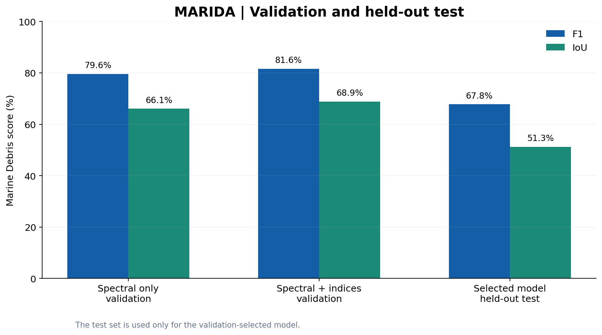
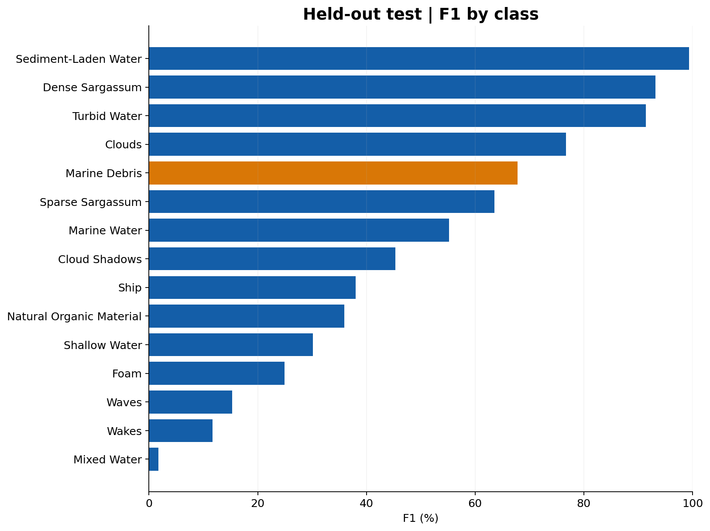
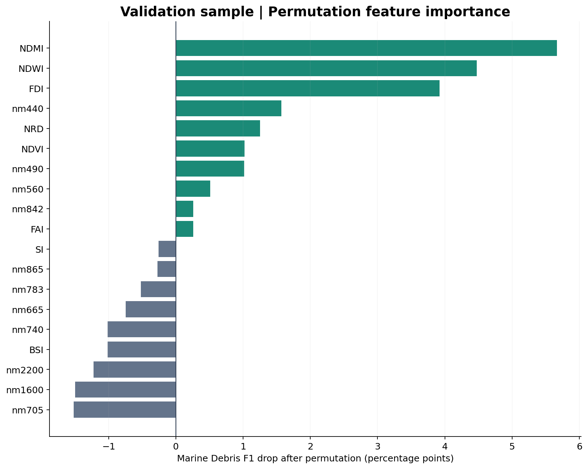

<div align="center">

# MARIDA-SpectralBench

**Spectral Feature Engineering and Error Analysis for Marine Debris Detection**

Pixel-level Random Forest benchmarks on Sentinel-2 remote-sensing data.

[](https://www.python.org/)
[](https://zenodo.org/records/5151941)
[](LICENSE)

[Overview](#overview) · [Benchmark Results](#benchmark-results) · [Visual Analysis](#visual-analysis) · [Reproduction](#reproduction) · [References](#references)


</div>

## Overview

Marine debris is difficult to distinguish from surface phenomena such as waves, ships, wakes, floating vegetation, and clouds in multispectral satellite observations. This repository evaluates **two pixel-level Random Forest baselines** on the [MARIDA](https://zenodo.org/records/5151941) benchmark and documents their failure modes.

The two compared feature sets are:

1. **Spectral-only** — 11 Sentinel-2 spectral bands.
2. **Spectral + indices** — the same 11 bands plus eight engineered indices: NDVI, FAI, FDI, SI, NDWI, NRD, NDMI, and BSI.

Experiments use the provided train/validation/test HDF5 splits, stratified per-class subsampling of **training pixels only**, and confidence-weighted learning. Both models use the same sampled training observations. Selection is based on *Marine Debris F1* on validation; only the selected model is evaluated on the held-out test set.

**Scope:** these are classical pixel classifiers, **not** vision-language foundation models or full-image segmentation networks. The spectral indices are deterministic transformations of the spectral bands; they do not constitute a second modality.

## Benchmark Results

The following results are from a completed MARIDA experiment using 100 trees, a fixed random seed (42), and at most 2,000 training pixels per class. Values are computed over the dataset's labeled pixels.

| Split | Model | Marine Debris F1 ↑ | IoU ↑ | Precision ↑ | Recall ↑ | Macro F1 ↑ |
|:--|:--|--:|--:|--:|--:|--:|
| Validation | Spectral-only RF | 0.7957 | 0.6607 | 0.7151 | 0.8967 | 0.4809 |
| Validation | Spectral + indices RF | **0.8157** | **0.6888** | **0.7475** | **0.8977** | **0.5546** |
| Held-out test | Selected spectral + indices RF | **0.6779** | **0.5127** | **0.5261** | **0.9528** | **0.5002** |

<div align="center">

</div>

Feature engineering improves validation Marine Debris F1 by **2.00 percentage points** and validation IoU by **2.81 percentage points**. However, the selected model's F1 falls by **13.79 percentage points** on held-out test data. Differences in class prevalence and scene composition may contribute; this gap alone does not establish overfitting.

Raw outputs are provided under [`results/benchmark/`](results/benchmark). A new local execution writes to `results/runs/latest/`, without overwriting the archived benchmark outputs.

## Visual Analysis

### Test-set classification by class



### Error analysis

For the Marine Debris class, the selected model recorded **363 true positives**, **327 false positives**, and **18 false negatives** on held-out test pixels. The high recall (0.9528) is accompanied by considerably lower precision (0.5261).


Wave, cloud, and ship pixels account for most false-positive Marine Debris predictions. Other classes are examined in the normalized confusion matrix:

<details>
<summary>View full 15-class test confusion matrix</summary>


</details>

### Spectral feature dependence



On the sampled validation subset, permuting NDMI, NDWI, and FDI produces the largest positive drops in Marine Debris F1. **Permutation importance measures model reliance, not causal or mechanistic explanation.** Correlated spectral bands and derived indices may distort individual feature rankings. Negative drops indicate the score improved following perturbation on this particular sample.

### Sampling protocol


The training set contains **429,412 labeled pixels**; **23,320 pixels** were selected for model fitting. Per-class quotas reduce training cost but alter the original class proportions.

## Dataset

The [MARIDA dataset](https://zenodo.org/records/5151941) contains **1,381** multispectral Sentinel-2 image patches of **256 × 256** pixels with sparse/weak pixel annotations for **15 marine classes**, confidence annotations, and official train/validation/test splits.

This repository uses the extracted annotated-pixel HDF5 (`dataset.h5`) for the Random Forest benchmark. Download and place it at:

```text
baseline/data/dataset.h5
```

The original GeoTIFF patches, class masks (`*_cl.tif`), confidence masks (`*_conf.tif`), GIS shapefiles, and split manifests may be stored under `baseline/data/` as well. Only the optional patch visualization script uses the original GeoTIFFs; model training and evaluation use the HDF5 export. **Dataset files and trained weights are excluded from Git.** See [Dataset and protocol](docs/dataset_and_protocol.md).

## Reproduction

**IDE:** PyCharm with Python 3.11 recommended. Install the packages in [`requirements.txt`](requirements.txt) using PyCharm's Python Interpreter / Packages interface. The code requires no terminal arguments, command-line parsers, or custom classes.

Open the project in PyCharm and run the following files in order using **Run**:

| File | Purpose | Saved outputs |
|:--|:--|:--|
| [`01_inspect_dataset.py`](baseline/01_inspect_dataset.py) | Inspect HDF5 splits and class balance | Split tables, distribution chart |
| [`02_train_random_forest.py`](baseline/02_train_random_forest.py) | Sample training pixels and fit two RF models | Training counts, timing table/charts, local `.joblib` models |
| [`03_evaluate_models.py`](baseline/03_evaluate_models.py) | Compare validation models, select one, evaluate once on test | Metrics, per-class CSVs, F1/IoU charts, confusion matrix |
| [`04_analyze_features.py`](baseline/04_analyze_features.py) | Permutation feature dependence on validation | Feature ranking CSV and plots |
| [`05_analyze_test_errors.py`](baseline/05_analyze_test_errors.py) | Report errors from the existing test confusion matrix | False-positive / false-negative tables and charts |
| [`06_visualize_satellite_patch.py`](baseline/06_visualize_satellite_patch.py) | Display one original multispectral patch and its masks | RGB, label and confidence montage; class-count CSV |

Change dataset location, sample quotas, and training parameters in [`baseline/settings.py`](baseline/settings.py). To reproduce the archived experiment, retain `RANDOM_SEED = 42`, `TRAIN_SAMPLES_PER_CLASS = 2000`, and `NUMBER_OF_TREES = 100`. Requirements may differ across operating systems; versions are declared but the original machine's complete lockfile was not captured.

All fresh tables and charts appear under `results/runs/latest/`; local model files are in `models/`. The archived outputs under `results/benchmark/` reflect the previously completed run and are retained separately. Never compare different runs as if they shared identical training settings without checking their configuration.

## Repository Layout

```text
MARIDA-SpectralBench/
├── README.md
├── LICENSE
├── requirements.txt
├── .gitignore
├── assets/
│   └── figures/            # Figures generated from archived experiment CSVs
├── baseline/
│   ├── settings.py          # Edit settings, paths and sample sizes here
│   ├── spectral_features.py # Shared spectral feature calculations
│   ├── 01_inspect_dataset.py
│   ├── 02_train_random_forest.py
│   ├── 03_evaluate_models.py
│   ├── 04_analyze_features.py
│   ├── 05_analyze_test_errors.py
│   ├── 06_visualize_satellite_patch.py
│   └── data/               # Local MARIDA data; not tracked
├── docs/
│   ├── dataset_and_protocol.md
│   └── experiment_notes.md
├── models/                 # Local model weights; not tracked
└── results/
    ├── benchmark/          # Archived CSV outputs from a real completed run
    └── runs/               # Outputs from subsequent local executions
```

## Limitations and Next Steps

- Weak/incomplete pixel annotations: evaluations cover only labeled pixels and should not be interpreted as dense whole-scene segmentation accuracy.
- Spectral-only pixel input: there are no learned spatial neighborhood features or full patch-level predictions.
- Classwise training subsampling shifts the training class prior; probabilities may be poorly calibrated.
- Class frequencies differ between the official validation and test splits; the reported performance gap requires further investigation.
- Single recorded seed and one fixed train configuration; statistical robustness and spatial generalization have not been established.
- Feature shuffling does not provide faithful mechanistic explanations of neural computation.

Current experiments establish a reproducible classical baseline. Proposed extensions include **spatial image models**, **remote-sensing foundation model comparisons**, **parameter-efficient adaptation**, and **retrieval-based evidence evaluation**. These extensions are not included in the present results.

## References

**Dataset and benchmark**

Kikaki, K., Kakogeorgiou, I., Mikeli, P., Raitsos, D. E., & Karantzalos, K. (2022). *MARIDA: A benchmark for Marine Debris detection from Sentinel-2 remote sensing data*. PLOS ONE, 17(1), e0262247. [https://doi.org/10.1371/journal.pone.0262247](https://doi.org/10.1371/journal.pone.0262247)

**Related research**

Liu, F., et al. (2024). *RemoteCLIP: A Vision Language Foundation Model for Remote Sensing*. IEEE Transactions on Geoscience and Remote Sensing. [https://doi.org/10.1109/TGRS.2024.3390838](https://doi.org/10.1109/TGRS.2024.3390838)

The present repository is an independent MARIDA baseline implementation and is **not affiliated with** the original MARIDA or RemoteCLIP authors.

## Maintainer

[Mehdi Hashemi](https://github.com/mehdi-hashemi-01) · [MIT License](LICENSE)
