<div align="center">

# MARIDA-SpectralBench

**From Spectral Random Forest Baselines to Multispectral U-Net and Pretrained DOFA Transfer**

*A reproducible, failure-driven study of multispectral marine debris detection using classical machine learning, deep segmentation and remote-sensing pretraining.*

[](https://www.python.org/)
[](https://pytorch.org/)
[](https://zenodo.org/records/5151941)
[](LICENSE)
[](#pretrained-dofa-frozen-feature-transfer-v06)

[Overview](#overview) · [RF Baseline](#benchmark-results) · [Feature Ablation](#feature-ablation-v03) · [Robustness](#multi-seed-robustness-and-scene-analysis-v031) · [Geographic Holdout](#geographic-holdout-v032) · [U-Net](#multispectral-u-net-segmentation-v04) · [U-Net Ablations](#controlled-u-net-training-ablations-v05) · [DOFA Transfer](#pretrained-dofa-frozen-feature-transfer-v06) · [Reproduce](#reproduction)


</div>

## Overview

Marine debris in Sentinel-2 observations can be confused with sediment-laden water, ships, wakes, waves, clouds, foam, and natural floating material. This repository follows those **measured failure modes** from pixel-level **Random Forest (RF)** baselines to an **11-band, 15-class U-Net** and a **pretrained DOFA ViT-Base encoder with a trainable segmentation decoder**. The emphasis is on transparent protocols, reproducible artifacts, and explicit evaluation boundaries.

The project asks five linked questions:

1. Do engineered spectral indices improve pixel-level debris detection over the 11 Sentinel-2 bands alone?
2. Are those improvements stable across training seeds, scene conditions, and held-out geographic Tile IDs?
3. Can a spatial segmentation model use neighboring pixels to reduce difficult false alarms?
4. Which training choices help or harm a multispectral U-Net on the official validation split?
5. Can frozen features from a wavelength-aware pretrained remote-sensing encoder improve pixel-level marine debris detection?

### Completed research stages

| Stage | Experiment | Status | Primary question |
|:--|:--|:--|:--|
| v0.1 | Spectral RF benchmark | Completed | Do 8 derived indices improve an 11-band RF baseline? |
| v0.2 | Visual error analysis + HDF5/GeoTIFF check | Completed | Where are the errors and are input values consistent? |
| v0.3 | Six-way spectral feature ablation | Completed | What changes when selected indices are removed and models retrained? |
| v0.3.1 | Five-seed robustness and scene analysis | Completed | Are feature effects and errors stable across seeds/scenes? |
| v0.3.2 | Leave-one-Tile-out RF evaluation | Completed | How does RF behave on held-out geographic Tile IDs? |
| v0.4 | 11-band, 15-class U-Net | Completed | Does learned spatial context improve marine debris detection? |
| v0.5 | Controlled U-Net training ablations | Completed on validation | Do loss weights, patch sampling, or spectral jitter improve U-Net? |
| **v0.6** | **Pretrained DOFA ViT-B frozen-feature transfer** | **Completed on validation** | **Does a frozen remote-sensing encoder with a trainable segmentation decoder improve detection?** |

**Scope:** RF uses individual labeled pixels; U-Net learns spatial features from entire patches; DOFA v0.6 supplies **frozen pretrained spatial tokens to a trainable decoder that also receives the 11 raw spectral bands**. All three methods produce 15-class pixel predictions, and **metrics are computed only on annotated pixels**. MARIDA mask value `0` means *unlabeled*, not clean water. The engineered spectral indices derive from the same 11 bands and are **not an additional modality**.

### Key results — read with their evaluation protocols

| Stage / model | Evaluation | Debris F1 | Precision | Recall | Interpretation |
|:--|:--|--:|--:|--:|:--|
| v0.1 — RF, 11 bands | Official validation | 0.7957 | 0.7151 | 0.8967 | Archived spectral baseline |
| v0.1 — RF, 19 features | Official validation | 0.8157 | 0.7475 | 0.8977 | Selected archived RF |
| v0.1 — RF, 19 features | **Official test** | **0.6779** | 0.5261 | 0.9528 | Historical test result |
| v0.2 — RF visual diagnostic | 60 selected validation patches | 0.5561 | 0.4113 | 0.8583 | **Not** full validation |
| v0.3 — RF, 19 features | Official validation, one new fit | 0.8187 | 0.7545 | 0.8949 | Separate seed-42 experiment |
| v0.3.1 — RF, 19 features | Official validation, 5-seed average | 0.8232 | 0.7623 | 0.8949 | F1 SD = 0.0107 |
| v0.3.2 — RF, 19 features | **Leave-one-Tile-out within official Train** | 0.3018 | 0.1838 | 0.8435 | Out-of-Tile pooled predictions |
| v0.3.2 — RF, without NDWI | Same grouped evaluation | **0.3504** | 0.2217 | 0.8363 | Strongly influenced by one Tile |
| v0.4 — U-Net, 11 bands | Official validation | 0.8009 | 0.7577 | 0.8493 | Best checkpoint: epoch 33 |
| v0.4 — U-Net, 11 bands | **Official test** | **0.3851** | 0.2510 | 0.8268 | Worse debris F1 than archived RF |
| v0.5 — U-Net `v04_replay` | Official validation only | **0.8286** | **0.8123** | 0.8456 | Best F1 among four v0.5 runs; no v0.5 test score |
| **v0.6 — DOFA ViT-B + segmentation decoder** | **Official validation only** | **0.7813** | 0.6889 | **0.9023** | Frozen pretrained encoder + raw-spectral skip; best epoch 10; no v0.6 test score |

**Do not interpret these as one common leaderboard.** The v0.2 subset, the grouped Train-only experiment, the official validation/test splits, the v0.1 RF, and separately trained U-Nets have different evaluation populations or training protocols. The official Test has been inspected in earlier stages; no further architecture/feature choices should be made *using* those test results. The v0.5 and v0.6 checkpoints were selected using **official Validation** and **not evaluated on Test**. The v0.6 number measures a frozen-encoder-plus-decoder system; it does not isolate the effect of pretraining.

## Benchmark Results

The recorded baseline experiment uses **100 trees**, random seed **42**, and a limit of **2,000 training pixels per class**. Training examples are sampled exclusively from the training split; both feature groups use the same sampled pixels. Sample weights reflect MARIDA annotation confidence. Models are compared on validation Marine Debris F1, and the selected model is evaluated once on the held-out test partition.

| Split | Model | Marine Debris F1 ↑ | IoU ↑ | Precision ↑ | Recall ↑ | Macro F1 ↑ |
|:--|:--|--:|--:|--:|--:|--:|
| Validation | Spectral-only RF | 0.7957 | 0.6607 | 0.7151 | 0.8967 | 0.4809 |
| Validation | Spectral + indices RF | **0.8157** | **0.6888** | **0.7475** | **0.8977** | **0.5546** |
| Held-out test | Selected spectral + indices RF | **0.6779** | **0.5127** | **0.5261** | **0.9528** | **0.5002** |

<p align="center">

</p>

Adding engineered indices improves **validation** Marine Debris F1 by **2.00 percentage points**, IoU by **2.81 percentage points**, and macro F1 by **7.37 percentage points**. Test Marine Debris F1 is **13.79 percentage points** below validation F1. A change in class prevalence and scene composition may contribute; the difference alone does not establish overfitting.

### Held-out test: where the classifier struggles

The selected classifier produced **363 true positives (TP), 327 false positives (FP), and 18 false negatives (FN)** for Marine Debris on the full test split. Its high debris recall (0.9528) is accompanied by substantially lower precision (0.5261).

<p align="center">

</p>

Wave, cloud, and ship pixels are the main sources of test-set false-positive debris predictions.

<details>
<summary><b>View test F1 by class and normalized confusion matrix</b></summary>

<p align="center">


</p>

</details>

### Training data and sampling

The original training split contains **429,412 labeled pixels**; **23,320** were retained for model fitting. Classwise sampling reduces computational cost but changes the class proportions observed during training.

<p align="center">

</p>

### Spectral feature dependence

<p align="center">

</p>

Permuting **NDMI**, **NDWI**, and **FDI** produced the largest positive reductions in Marine Debris F1 on the sampled validation data. These scores indicate **model dependence**, not causal importance or mechanistic interpretability. Related spectral bands and indices are correlated; rankings can change with sample selection and perturbations. A negative importance value means that shuffling the feature improved the score on that particular sample.

## Validation Patch-Level Error Analysis

To inspect *where* classification mistakes occur, the selected `spectral_plus_indices` Random Forest was applied to **60 validation GeoTIFF patches**, and predictions were compared against their corresponding class masks. The visualization includes satellite RGB composites, annotated ground truth, model predictions, error maps, and overlays.

**Evaluation rule:** Metrics and error maps are computed from **annotated pixels only**. Unlabeled pixels are not assumed to be clean water, background, or negatives. The RGB composites are intended for human inspection; the classifier uses the 11-band spectral measurements, not the rendered RGB image.

### Diagnostic subset results

| Metric | Value |
|:--|--:|
| Inspected validation patches | 60 |
| Evaluated labeled pixels | 102,285 |
| Marine Debris true positives | 109 |
| Marine Debris false positives | 156 |
| Marine Debris false negatives | 18 |
| Marine Debris precision | 0.4113 |
| Marine Debris recall | 0.8583 |
| Marine Debris F1 | 0.5561 |

These figures pool labeled-pixel counts across the inspected patches; they are **not** the mean of per-patch F1 values. Patches with no positive labels and no positive predictions do not have a meaningful positive-class F1. This subset has a different distribution from the complete validation and test partitions, so its metrics should not be interpreted as an overall performance regression.

<p align="center">
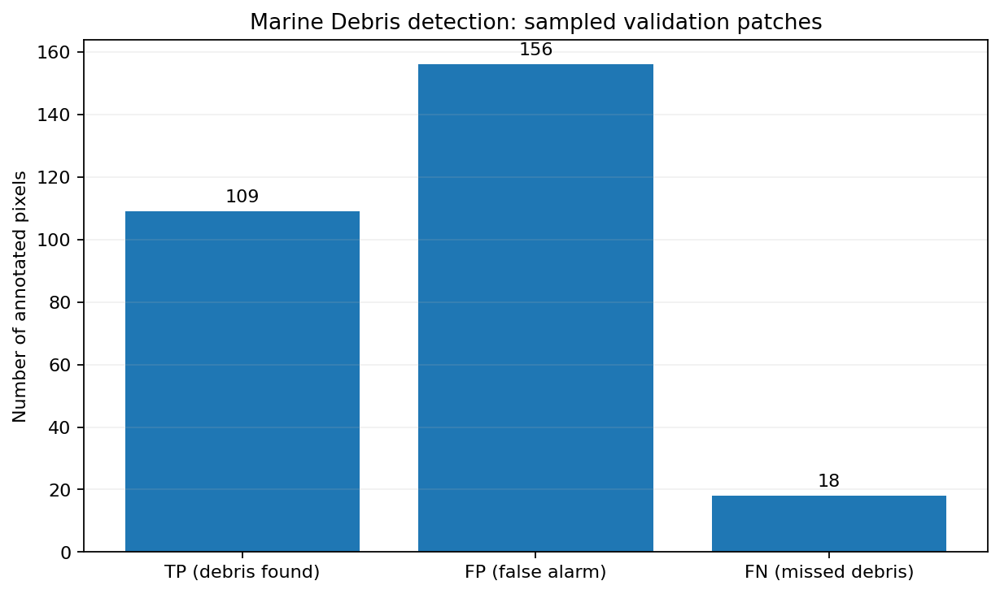
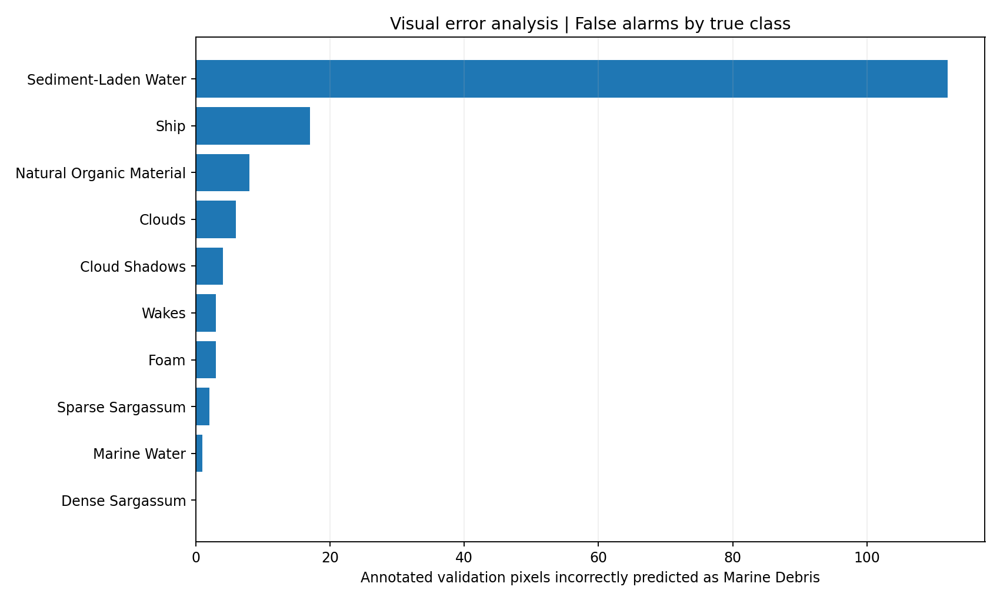
</p>

Of the **156 false positives**, **112 (71.8%)** occur in one patch, `S2_11-6-18_16PCC_26.tif`, with the true class **Sediment-Laden Water**. These 112 annotated pixels have **high-confidence labels**. This concentration motivates a focused investigation of sediment-rich scenes; the plots alone do not identify the physical cause of confusion.

### Case study A: sediment-laden water mistaken for debris

**Patch:** `S2_11-6-18_16PCC_26.tif` — **0 TP · 112 FP · 0 FN**

<p align="center">

</p>

False-positive debris predictions cluster in a localized sediment-laden region. Whether these errors stem from overlapping spectral signatures, scene-specific conditions, or other factors remains to be tested. This is a **failure observation**, not evidence of a confirmed causal mechanism.

### Case study B: missed debris within a narrow surface feature

**Patch:** `S2_18-9-20_16PCC_39.tif` — **45 TP · 0 FP · 13 FN**

<p align="center">

</p>

Of the 13 missed debris pixels, **10 were predicted as Clouds** and **3 as Waves**. This image motivates testing whether spatial context helps distinguish debris from nearby surface phenomena; an isolated case study cannot establish an overall advantage of spatial models.

<details>
<summary><b>Additional validation cases</b></summary>

The following patches illustrate other error types without establishing their prevalence across the complete dataset.

| Patch | Observed error pattern |
|:--|:--|
| `S2_18-1-18_48PZC_25.tif` | 6 FP associated with cloud/cloud-shadow labels |
| `S2_18-9-20_16PCC_64.tif` | 4 FP associated with ship labels |
| `S2_18-9-20_16PCC_29.tif` | 3 FP and 2 FN across a mixed scene |

<p align="center">

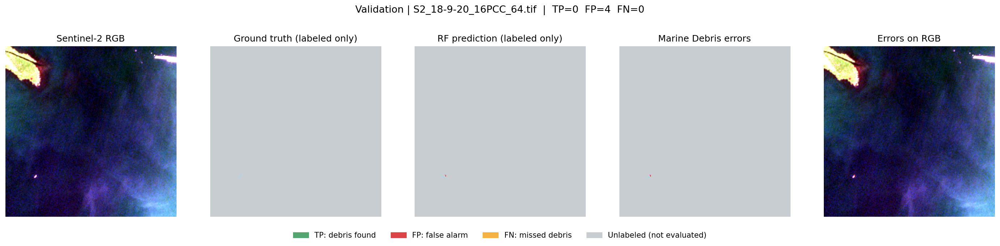
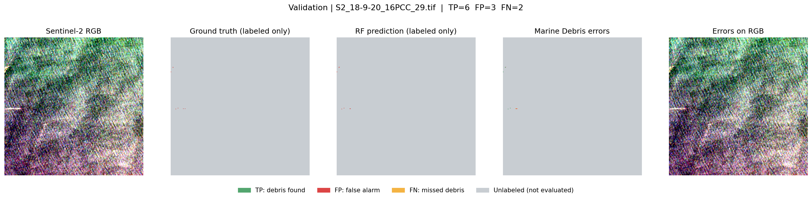
</p>

</details>

**Outputs:** `results/visual_analysis/` contains the diagnostic subset summary, a per-patch error table, false-positive counts grouped by true class, and the pixel locations of analyzed errors. Figures are saved under `assets/figures/visual_errors/`.

## HDF5–GeoTIFF Consistency Check

The original Random Forest was trained on the annotated-pixel `dataset.h5` export, whereas patch-level visual diagnostics read the multispectral GeoTIFFs. We therefore checked whether spectral signatures and annotated classes agreed between the two sources **before interpreting localized failure cases**.

The consistency script matches HDF5 records for selected patches to **labeled GeoTIFF pixels using their 11-dimensional spectral signatures**, then checks the label at the matched location. The check allows numerical tolerance and tests common scaling factors.

### Recorded verification results

| Validation patch | HDF5 rows checked | Near spectral match | Spectral + label agreement | Best scale factor | Status |
|:--|--:|--:|--:|--:|:--|
| `S2_11-6-18_16PCC_26.tif` | 200 | 100% | 100% | 1.0 | PASS |
| `S2_18-9-20_16PCC_39.tif` | 200 | 100% | 100% | 1.0 | PASS |
| `S2_18-9-20_16PCC_29.tif` | 11 | 100% | 100% | 1.0 | PASS |
| **Total / sampled check** | **411** | **100%** | **100%** | — | **3/3 PASS** |

The three patches contain **8,677**, **443**, and **11** labeled GeoTIFF pixels respectively; the verification examines up to 200 HDF5 rows per patch. The selected records matched at the configured tolerance **without rescaling**.

**Verification boundaries:**

- Matching is based on nearby spectral signatures and class agreement, **not** an independently established one-to-one mapping from HDF5 coordinates to raster row/column indices.
- `XCoords`/`YCoords` were not verified as raster pixel indices (`not_pixel_coordinates` in the script output). **Spatial coordinate agreement remains unverified.**
- A nearest-spectral-signature match can be ambiguous when several pixels share identical or similar spectra.
- The result covers **411 sampled records in three selected patches**, not the full archive, and does not independently validate the GeoTIFF georeferencing, every pixel prediction, or every annotation.

This check substantially reduces concern about a simple **band-value or scaling mismatch** in these inspected examples. It does not prove a particular explanation for the model errors.

The script exports `results/data_consistency/data_consistency_summary.csv`, `results/data_consistency/band_differences.csv`, and `assets/figures/data_consistency/band_differences.png`.

<details>
<summary><b>View per-band difference visualization</b></summary>

<p align="center">

</p>

</details>

## Feature Ablation (v0.3)

The initial permutation analysis suggested that **NDMI**, **NDWI**, and **FDI** were influential for the fitted model. However, shuffling an input in a trained model does not tell us what happens if that input is **removed and the model is retrained**. We therefore performed a controlled feature ablation on the annotated-pixel MARIDA HDF5 data.

### Experimental protocol

- Six feature sets: `full_19` (all 11 spectral bands + 8 indices), `minus_ndmi`, `minus_ndwi`, `minus_fdi`, `minus_three` (all three removed), and `bands_only` (11 raw bands).
- Fixed seed **42**, **100 trees**, `min_samples_leaf=2`, up to **2,000 training pixels per class**, and confidence-based sample weights (High = 1, Moderate = 0.5, Low = 1/3).
- All six models are trained on the **same 23,320 sampled training pixels** and evaluated on **all 213,102 labeled validation pixels**; median imputation uses training data only.
- The **test partition is not used** for selecting ablation features or comparing these variants.
- Feature selection is performed before fitting each model. The engineered features still originate from the same 11 spectral bands; no additional remote-sensing modality is introduced.

### Single-seed validation results

| Feature set | # features | Debris F1 ↑ | Precision ↑ | Recall ↑ | IoU ↑ | Debris FP ↓ | Sediment-water FP ↓ |
|:--|--:|--:|--:|--:|--:|--:|--:|
| **All features (`full_19`)** | 19 | **0.8187** | **0.7545** | 0.8949 | **0.6931** | **313** | 112 |
| Without NDMI | 18 | 0.8028 | 0.7286 | 0.8940 | 0.6706 | 358 | 115 |
| Without NDWI | 18 | 0.8116 | 0.7504 | 0.8837 | 0.6830 | 316 | 69 |
| Without FDI | 18 | 0.8045 | 0.7301 | **0.8958** | 0.6730 | 356 | 142 |
| Without NDMI, NDWI, FDI | 16 | 0.7945 | 0.7162 | 0.8921 | 0.6591 | 380 | **65** |
| Original spectral bands only | 11 | 0.7890 | 0.7072 | 0.8921 | 0.6515 | 397 | 99 |

<p align="center">
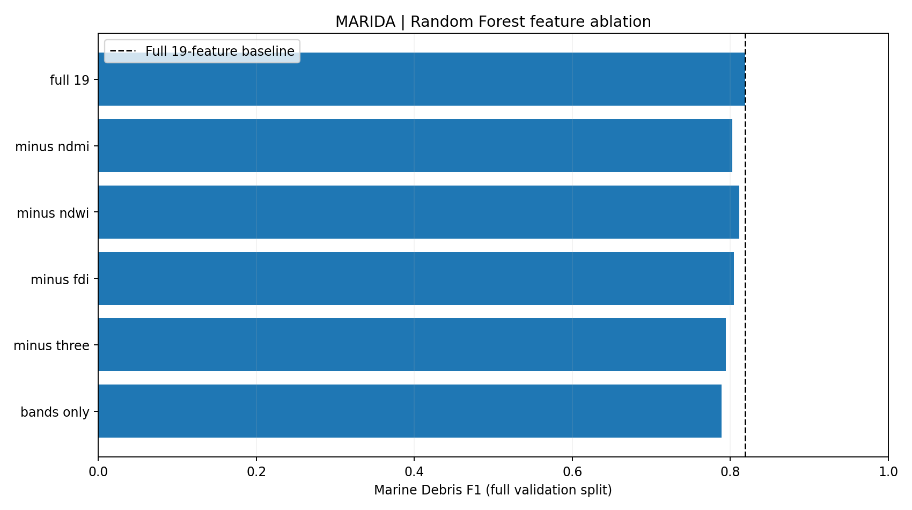
</p>

**Finding:** Within this seed-42 experiment, removing any of the three selected indices reduces *overall* Marine Debris F1. Removing NDWI reduces the sediment-laden-water false positives from **112 to 69** (43 fewer; **38.4%**), but increases the total false positives from **313 to 316** and false negatives from **113 to 125**. It also increases ship-to-debris errors (**66 to 94**) and wake-to-debris errors (**21 to 46**). Reducing one type of error is not equivalent to improving the complete validation benchmark.

<p align="center">
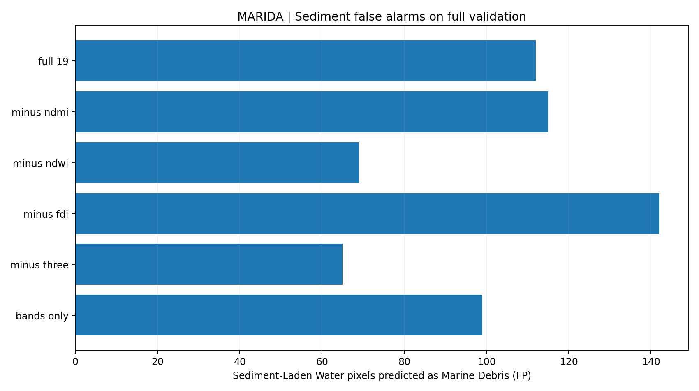
</p>

The known sediment example `S2_11-6-18_16PCC_26.tif` contains no annotated Marine Debris and is the source of **all 112 sediment-related false positives for the full model in this validation run**. This example is useful for diagnosis, but it is **not** an independent test or a sufficient basis for dropping NDWI. The experiment supports feature-set *associations within this benchmark*, not a causal explanation of the spectral indices.

**Artifacts:** `results/ablation/validation_comparison.csv`, `false_positives_by_true_class.csv`, `known_validation_patch_comparison.csv`, `run_config.json`, and plots in `assets/figures/ablation/`. See [`docs/feature_ablation.md`](docs/feature_ablation.md).

## Multi-Seed Robustness and Scene Analysis (v0.3.1)

The one-seed ablation cannot show whether feature rankings remain consistent when the training sample and forest randomness change. We therefore repeated all six ablation variants with seeds **42, 7, 21, 123, and 2026** (**5 seeds × 6 feature sets = 30 fitted models**). Within each seed, all models use the same selected training observations; across seeds, sampling and model randomness change. Every model is evaluated against the **same 213,102 labeled validation pixels**, with no new test-set tuning.

### Stability across five seeds

| Feature set | Mean Debris F1 ↑ | SD of F1 | Mean FP ↓ | Mean FN ↓ | Mean sediment FP ↓ |
|:--|--:|--:|--:|--:|--:|
| **All 19 features** | **0.8232** | 0.0107 | **300.4** | 113.0 | 100.8 |
| Without FDI | 0.8131 | 0.0118 | 331.0 | 112.2 | 125.0 |
| Without NDMI | 0.8123 | **0.0079** | 337.4 | 109.2 | 113.4 |
| Without NDWI | 0.8061 | 0.0055 | 330.8 | 126.0 | 90.2 |
| Spectral bands only | 0.8047 | 0.0110 | 361.2 | **108.4** | **64.6** |
| Without all three | 0.7745 | 0.0126 | 448.4 | 112.6 | 114.8 |

SD is the sample standard deviation of the five *seed-level F1 values*, not a 95% confidence interval. Mean error counts can be fractional because they are averages of integer counts over five fits.

<p align="center">
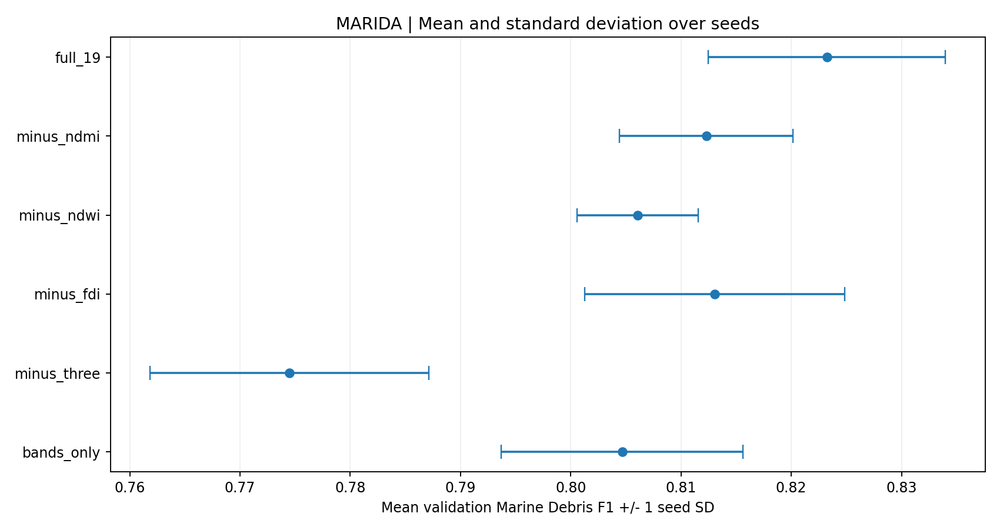
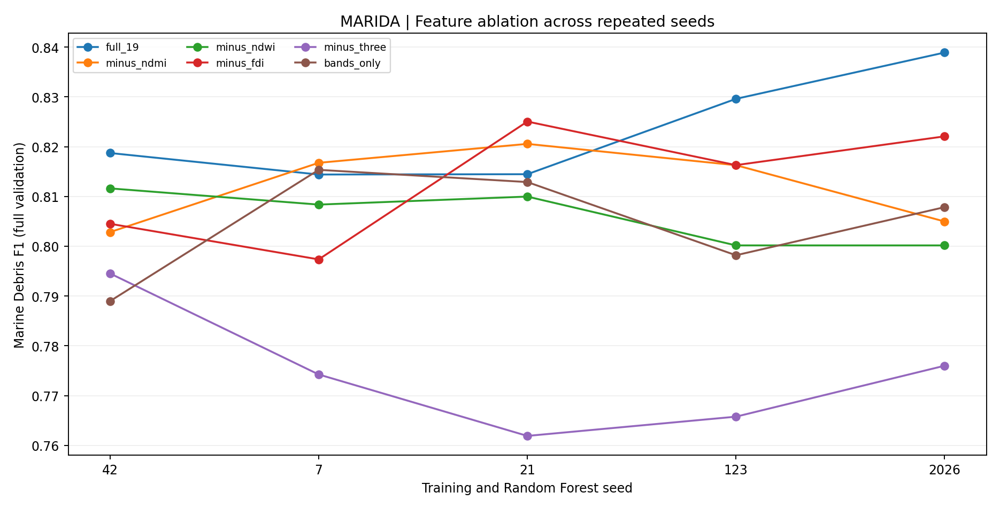
</p>

The full 19-feature model leads the **mean F1** ranking and wins in **3 of 5 seeds**. The best model per seed is:

| Seed | Highest-F1 feature set | Winning F1 |
|--:|:--|--:|
| 42 | All 19 features | 0.8187 |
| 7 | Without NDMI | 0.8168 |
| 21 | Without FDI | 0.8250 |
| 123 | All 19 features | 0.8296 |
| 2026 | All 19 features | 0.8389 |

In **all five paired seed comparisons**, removing NDWI lowers F1 relative to the corresponding full model. On average, dropping NDWI changes F1 by **−0.0172** (−1.72 percentage points), FP by **+30.4**, and FN by **+13.0**. This supports retaining NDWI for the current validation objective, despite its mixed effects on sediment-laden-water errors. These are *within-validation* findings; five seeds do not prove statistical superiority on unseen regions.

### Where errors concentrate: acquisition groups and patches

Each patch is identified by `Date + Tile + Image`. We aggregate patches by **`Date + Tile`** as an *acquisition-group proxy* and by `Tile` as a broad *geographic-ID proxy*. This describes how observed errors are distributed; it is **not** grouped cross-validation or a scene-independent holdout.

Across the validation split there are **328 distinct patches**, **12 Date+Tile acquisition groups**, and **7 distinct Tile identifiers**.

| Date + Tile | Labeled pixels | Mean debris FP | FP per 1,000 labeled px | Mean debris FN | Main observed issue |
|:--|--:|--:|--:|--:|:--|
| **11-6-18 / 16PCC** | 29,232 | **126.0** | 4.31 | 1.0 | Sediment-laden water |
| **18-9-20 / 16PCC** | 75,662 | **87.6** | 1.16 | **76.4** | Ships/wakes and missed debris |
| 18-1-18 / 48PZC | 4,902 | 20.4 | 4.16 | 1.6 | Ships/clouds |
| 12-1-17 / 16PEC | 7,681 | 16.6 | 2.16 | 0.0 | Ships |
| 29-12-20 / 18QYF | 1,965 | 13.8 | 7.02 | 1.4 | Clouds |

<p align="center">
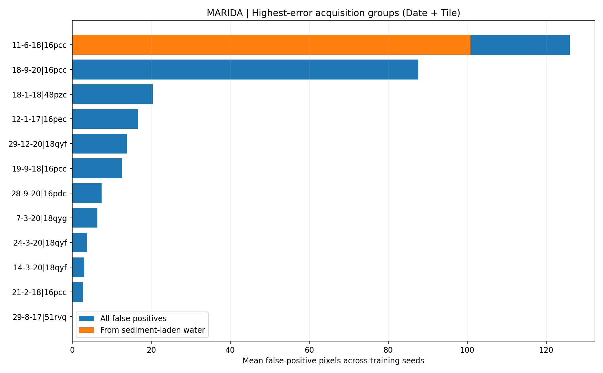
</p>

The first two acquisition groups together account for about **71.1%** of the full model's mean false positives (213.6 of 300.4). The `18-9-20 / 16PCC` group accounts for **76.4 of 113.0 mean false negatives** (about **67.6%**). Within it, patch `S2_18-9-20_16PCC_17.tif` has **38 labeled debris pixels** and **32.2 missed debris pixels on average**, making it a priority for subsequent visual inspection.

Error counts depend on annotation coverage. For example, `24-3-20 / 18QYF` has only **94 labeled pixels**, so even **3.8 mean FP** corresponds to **40.43 FP per 1,000 labeled pixels**. Such small-denominator rates require caution. None of these labeled-pixel rates is a whole-scene false-alarm rate over every pixel.

### Does dropping NDWI consistently fix sediment false positives?

Not consistently. The sediment-related errors in these validation evaluations are concentrated in **one patch**, `S2_11-6-18_16PCC_26.tif`, and the effect of removing NDWI changes across seeds:

| Seed | Sediment FP: full 19 | Sediment FP: without NDWI | Change |
|--:|--:|--:|:--|
| 42 | 112 | 69 | 43 fewer |
| 7 | 113 | 72 | 41 fewer |
| 21 | 129 | 78 | 51 fewer |
| 123 | 87 | 107 | 20 more |
| 2026 | 63 | 125 | 62 more |
| **Mean** | **100.8** | **90.2** | **10.6 fewer** |

Removing NDWI reduces sediment FP for **3 seeds** and increases it for **2**. Across **all** validation scenes, the full model still has lower mean total FP (**300.4 vs 330.8**), lower mean FN (**113.0 vs 126.0**), and higher mean F1 (**0.8232 vs 0.8061**). The `18-9-20 / 16PCC` group alone incurs **24.8 additional FP** and **9.0 additional FN** on average without NDWI.

<p align="center">
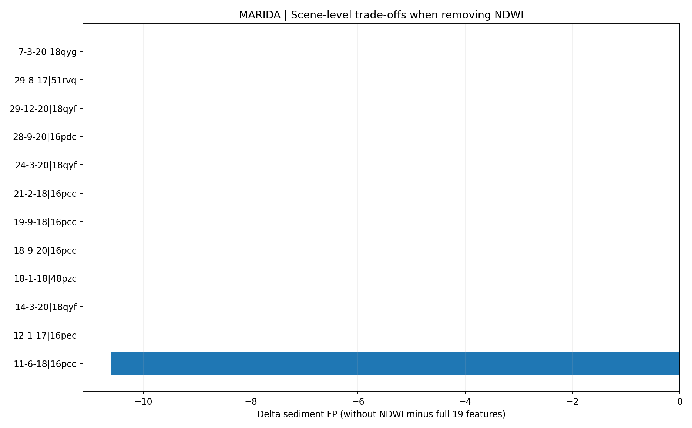
</p>

A **descriptive sensitivity check** resampled the 12 complete Date+Tile groups **1,000 times**, using paired predictions from seed 42. The percentile range for `F1(without NDWI) − F1(full)` was **[−0.0372, +0.0380]**, or **−3.72 to +3.80 percentage points**. This interval describes sensitivity to the mixture of acquisition groups in the *existing* validation set. It is **not** a formal 95% confidence interval for future regions or an independent test estimate.

### Train–validation metadata overlap

To assess whether the existing split supports a strong claim of spatial independence, we checked shared group identifiers between the official train and validation tables:

| Identifier granularity | Train groups | Validation groups | Identifiers shared |
|:--|--:|--:|--:|
| Exact Patch (`Date + Tile + Image`) | 694 | 328 | **0** |
| Acquisition proxy (`Date + Tile`) | 36 | 12 | **0** |
| Geographic proxy (`Tile`) | 13 | 7 | **5** |

The shared Tile IDs are `16PCC`, `16PDC`, `16PEC`, `18QYF`, and `48PZC`. Thus **5 of 7 distinct validation Tile IDs (71.4%)** also occur in training. This percentage is **of Tile identifiers**, not of validation pixels or geographic surface area.

**Interpretation:** No *identically labeled* Patch ID or Date+Tile ID is shared in this check; however, five broad geographic Tile identifiers appear in both splits. Shared Tile names **do not establish duplicate-pixel leakage**, and distinct IDs **do not prove spatial independence**. The official split is therefore not a demonstrated geographic holdout. Claims of generalization to new geographic areas require a genuinely group-disjoint evaluation with adequate debris-class coverage.

**Artifacts:** `results/robustness/per_seed_validation.csv`, `summary_by_model.csv`, `paired_summary.csv`, `scene_error_summary.csv`, `patch_error_summary.csv`, `scene_ndwi_tradeoff.csv`, `train_val_group_overlap.csv`, `scene_bootstrap_descriptive.csv`, `run_config.json`, and plots in `assets/figures/robustness/`. The automatically generated narrative is stored in `results/robustness/robustness_findings.md`. See [`docs/robustness_and_scene_analysis.md`](docs/robustness_and_scene_analysis.md).

## Geographic Holdout (v0.3.2)

The official MARIDA train and validation partitions share five broad Tile identifiers. To evaluate a stricter grouping rule, we performed **leave-one-Tile-out cross-validation using only the official HDF5 training split**. For each of the **13 Tile IDs**, the held-out Tile contributed no training pixels to its own fold. The official validation and test partitions were **not opened** by this experiment.

**Protocol:** 100-tree Random Forest (`min_samples_leaf=2`), seed 42, confidence-weighted fitting, at most 2,000 training pixels per class, training-only median imputation, and matched training samples for the three feature sets within each fold. Aggregation covers **429,412 annotated pixels**, including **1,943 labeled Marine Debris pixels**.

### Pooled out-of-Tile results

| Feature set | Debris F1 ↑ | Precision ↑ | Recall ↑ | IoU ↑ | TP | FP ↓ | FN ↓ |
|:--|--:|--:|--:|--:|--:|--:|--:|
| Full 19 features | 0.3018 | 0.1838 | **0.8435** | 0.1777 | **1,639** | 7,278 | **304** |
| **Without NDWI** | **0.3504** | **0.2217** | 0.8363 | **0.2124** | 1,625 | **5,706** | 318 |
| 11 spectral bands only | 0.2609 | 0.1549 | 0.8260 | 0.1500 | 1,605 | 8,755 | 338 |

Dropping NDWI improves pooled F1 by **4.86 percentage points**, with **1,572 fewer false positives** but **14 more false negatives**. However, the pooled ranking is dominated by a difficult held-out Tile; this is **not evidence that removing NDWI is universally superior**.

<p align="center">
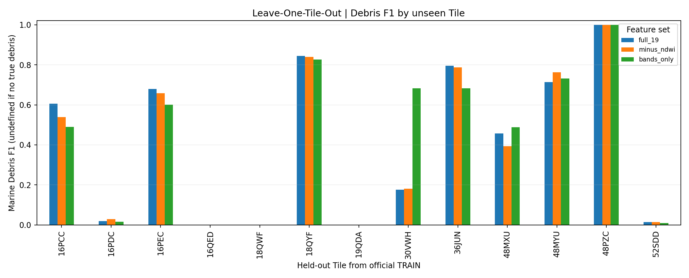
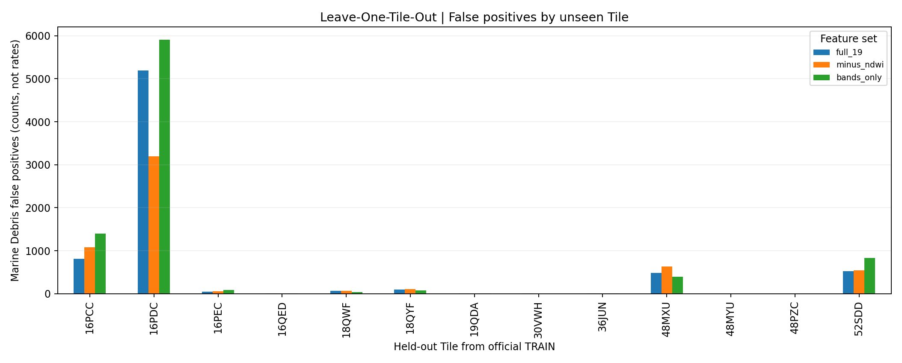
</p>

### A geographically concentrated failure: Tile `16PDC`

- **5,194/7,278 RF false positives (71.4%)** occur in held-out `16PDC`; **5,169** of those are labeled **Sediment-Laden Water**.
- The acquisition group `18-9-20 / 16PDC` contributes **5,175** of the Tile's false positives.
- On Tile `16PDC`, full RF records **53 TP, 5,194 FP, 14 FN** (**F1 = 0.0199**). Removing NDWI lowers FP to **3,192**, but its F1 remains only **0.0296**.
- For comparison, the full RF scores **0.8444** on held-out `18QYF` (606 labeled debris pixels), showing substantial variation between regions.

The **Tile-macro F1** over the ten Tiles with labeled debris is **0.5309** (full 19), **0.5204** (without NDWI), and **0.5527** (11 bands). Three additional Tiles have *no annotated debris*, so positive-class F1 is undefined for them, although their false positives count in pooled results. Some evaluated Tiles have just **2–4 positive pixels**, making their per-Tile F1 highly unstable.

A **post-hoc sensitivity check**, *not a replacement benchmark*, excludes `16PDC` from pooled arithmetic: full RF F1 becomes **0.5719** versus **0.5283** without NDWI, reversing the ranking. The main reported result **retains all Tiles**.

**Interpretation:** held-out Tile identifiers are fully disjoint *by identifier* in each fold, but true spatial footprint disjointness was not independently verified. This is **grouped cross-validation within official Train**, not a fresh external geographic test. Its lower F1 cannot be attributed solely to geography because the fit/evaluation observations and protocol differ from the official validation comparison. See [geographic holdout protocol](docs/geographic_holdout.md) and `results/geographic_holdout/`.

## Multispectral U-Net Segmentation (v0.4)

A lightweight **U-Net** was trained for 15-class segmentation from **11 Sentinel-2 bands** to test whether learned spatial neighborhoods help distinguish Marine Debris from other surface phenomena. Its input is a `11 × 256 × 256` patch; its output is a set of 15 class-score maps at full image resolution.

**Training protocol:** 694 train / 328 validation / 359 test patches; seed 42; 35 maximum epochs; batch size 4; 16 base channels; AdamW (`3e-4`); training-only per-band normalization; geometric flips/rotations; class-frequency-weighted and annotation-confidence-weighted masked cross-entropy; debris-positive patch sampling. Unlabeled mask value `0` is excluded from loss and all reported pixel metrics. The best model was selected by **pooled validation Marine Debris F1**, at **epoch 33**.

**Execution:** NVIDIA GeForce **RTX 5070 Laptop GPU**; GPU forward and official split checks passed with the recorded PyTorch/CUDA installation. Checkpoint is saved locally at `models/unet_best.pt` and should not be committed as an ordinary source file.

### Official split performance compared with the archived RF

| Model / split | Debris F1 ↑ | Precision ↑ | Recall ↑ | IoU ↑ | TP | FP ↓ | FN ↓ |
|:--|--:|--:|--:|--:|--:|--:|--:|
| RF 19 features — validation | **0.8157** | 0.7475 | **0.8977** | **0.6888** | — | — | — |
| U-Net 11 bands — validation | 0.8009 | **0.7577** | 0.8493 | 0.6679 | 913 | 292 | 162 |
| RF 19 features — **test** | **0.6779** | **0.5261** | **0.9528** | **0.5127** | 363 | **327** | **18** |
| U-Net 11 bands — **test** | 0.3851 | 0.2510 | 0.8268 | 0.2385 | 315 | 940 | 66 |

On the official test, U-Net trails the archived RF by **29.28 F1 percentage points** and yields **613 more FP** and **48 more FN**. This is an observed model comparison, **not** proof that spatial modeling is intrinsically worse: the two model families use different feature sets and training objectives.

<p align="center">
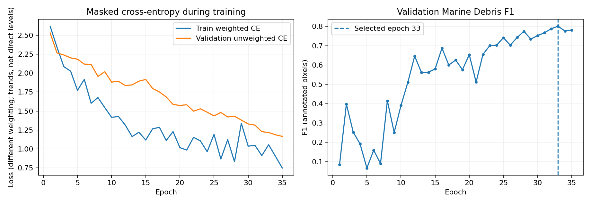
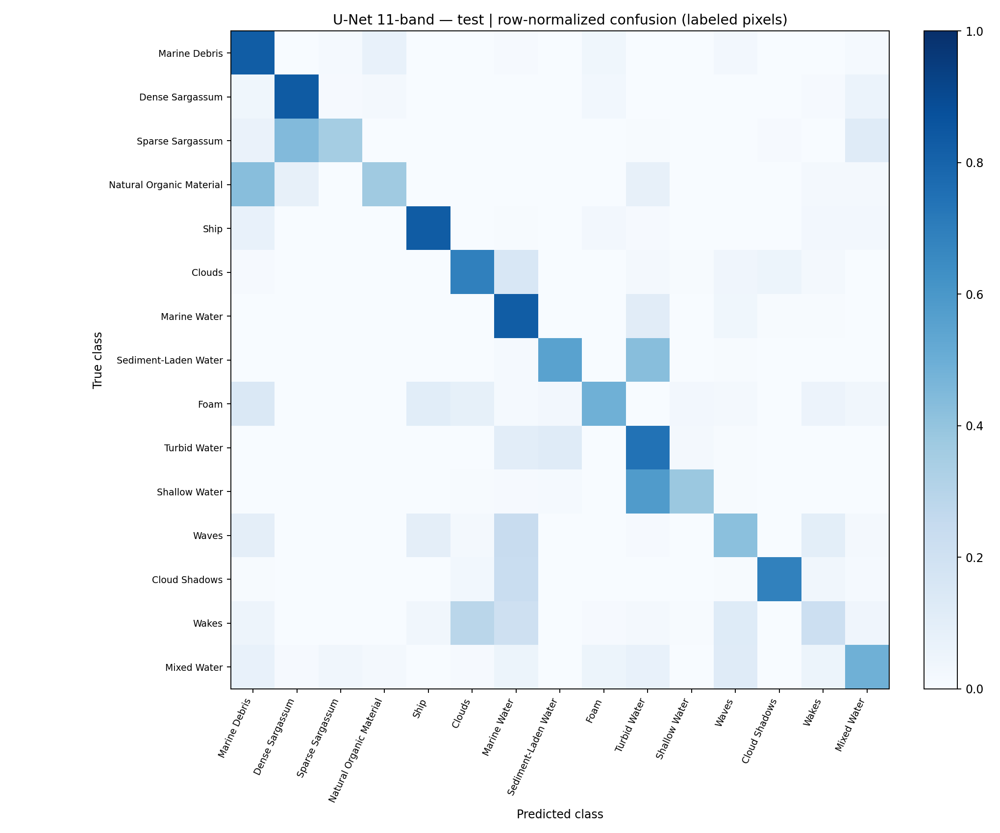
</p>

### What the test error analysis revealed

- **940** test false-positive debris predictions: **378 Clouds**, **177 Waves**, **88 Ship**, **77 Wakes**, **56 Sparse Sargassum**, **56 Foam**, and **108 other**. Clouds plus Waves account for **59.0%** of these false positives.
- Patch `S2_3-11-16_16PDC_7.tif` contains **no labeled debris** yet generates **276 test FP**. It is an important diagnostic example, but the original visualization sample did not include it.
- In contrast, a *previously examined validation patch*, `S2_11-6-18_16PCC_26.tif`, had **112 RF FP** from sediment-laden water and **0 U-Net FP**. This improvement is **local to that example** and does not establish better generalization.

<p align="center">
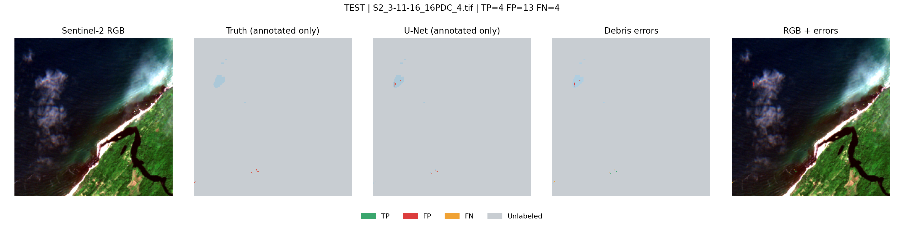
</p>

The v0.4 U-Net test **macro F1 across present classes** is **0.5077**, compared with approximately **0.5002** in the archived RF report. This does **not** contradict the RF's higher *Marine Debris* F1, which is the primary objective. The official test has now been inspected: further tuning must use training/validation only, and independent evidence is needed for a final generalization claim. See [U-Net protocol](docs/unet_segmentation.md) and `results/unet/`.

## Controlled U-Net Training Ablations (v0.5)

After v0.4, we isolated **three training choices** rather than immediately increasing model capacity. Importantly, v0.4 **already used class weights, debris-positive patch oversampling, and geometric augmentation**. Four fresh 11-band/15-class U-Net training runs used the **same official Train/Validation split and seed 42**:

1. `v04_replay` — replay the v0.4 training recipe (reference).
2. `no_class_weights` — turn off class-frequency loss weights, retaining label-confidence weights.
3. `no_debris_oversampling` — sample patches uniformly rather than preferentially sampling debris-containing training patches.
4. `extra_spectral_jitter` — add small training-only reflectance gain/noise perturbations to the reference recipe.

The best checkpoint for each run was chosen from **official validation only**. Each is an independent fitted model. **The official Test was not opened or scored for v0.5.** In the artifacts supplied so far, training histories and best-validation confusion matrices are available; complete per-patch results from script 19 were not included.

### v0.5 results: 213,102 labeled validation pixels

| Training configuration | Best epoch | Debris F1 ↑ | Precision ↑ | Recall ↑ | IoU ↑ | TP | FP ↓ | FN ↓ |
|:--|--:|--:|--:|--:|--:|--:|--:|--:|
| **`v04_replay`** | 33 | **0.8286** | 0.8123 | 0.8456 | **0.7074** | 909 | 210 | 166 |
| `no_class_weights` | 22 | 0.8203 | 0.7791 | **0.8660** | 0.6953 | **931** | 264 | **144** |
| `no_debris_oversampling` | 22 | 0.8224 | **0.8330** | 0.8121 | 0.6984 | 873 | **175** | 202 |
| `extra_spectral_jitter` | 4 | 0.6462 | 0.5715 | 0.7433 | 0.4773 | 799 | 599 | 276 |

**No single-change ablation improved overall validation Marine Debris F1 over the matched reference.** Removing oversampling reduces false positives by **35** and improves precision by **2.07 percentage points**, but increases false negatives by **36**. Removing class-frequency weights increases recall by **2.05 percentage points**, but raises FP by **54**. Additional spectral jitter reduces F1 by **18.24 percentage points** under the tested settings; it should not be generalized to all spectral augmentation schemes.

<p align="center">
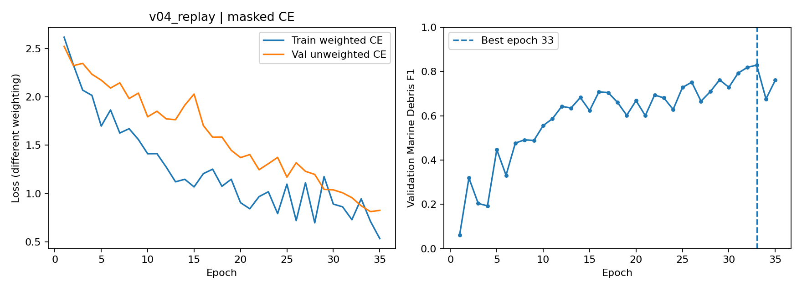
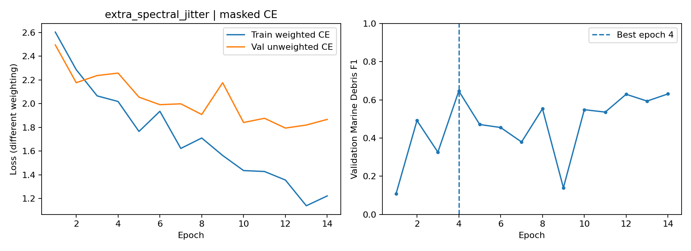
</p>

### Cloud/wave confusion on **validation**, by direction

| Configuration | Clouds → Debris (FP) | Waves → Debris (FP) | Debris → Clouds (FN) | Debris → Waves (FN) |
|:--|--:|--:|--:|--:|
| `v04_replay` | **0** | 2 | **10** | 12 |
| `no_class_weights` | 2 | 2 | 35 | 3 |
| `no_debris_oversampling` | 16 | **0** | 12 | **2** |
| `extra_spectral_jitter` | 21 | 3 | 33 | 7 |

The interventions **do not consistently improve both error directions**. For instance, removing oversampling reduces the number of debris pixels predicted as Waves (12 → 2) but increases Clouds predicted as debris (0 → 16). These **v0.5 validation** counts must **not** be directly compared with **v0.4 test** cloud/wave counts.

### Does v0.5 beat the RF baseline?

The best v0.5 U-Net has **0.8286 validation F1**, **1.29 percentage points higher** than the archived 19-feature RF validation F1 (**0.8157**). However, this is **one seed**, the RF and U-Net are not training-condition-matched, and **there is no v0.5 test or group-disjoint score**. Moreover, the best variant is a **replay of the old recipe**, not evidence that a new training change improved the model.

**Current research decision:** retain `v04_replay` as the best *validation-F1* v0.5 checkpoint. The `no_debris_oversampling` alternative trades lower recall for fewer alarms. Neither is established as better than RF on independent scenes or new geography. See [v0.5 experiment protocol](docs/unet_v05_controlled_ablation.md) and `results/unet_v05/`.

## Pretrained DOFA Frozen-Feature Transfer (v0.6)

To test a remote-sensing foundation-model approach, we implemented a **wavelength-conditioned DOFA ViT-Base encoder** with its real, pretrained weights, followed by a trainable **15-class segmentation decoder**. Unlike the earlier U-Net, DOFA is pretrained on remote-sensing imagery. In this first experiment, however, the **encoder is frozen**; no DOFA transformer weights are fine-tuned.

### Architecture and verified pretrained checkpoint

The 11 MARIDA spectral bands are supplied in their original order, along with their central wavelengths in micrometres. DOFA extracts spatial representations from each **11 × 256 × 256** patch. Its cached spatial tokens form a **16 × 16** grid; a decoder upsamples these representations to a **15 × 256 × 256** prediction. The decoder also has a **raw-spectral skip connection**, so its performance cannot be attributed entirely to pretrained features.

The `20_prepare_dofa.py` execution log confirms that the official pretrained checkpoint was loaded successfully:

| Verification item | Recorded outcome |
|:--|:--|
| Encoder | DOFA ViT-Base (`DOFA_ViT_base_e100.pth`) |
| Pretrained tensor coverage | **100.00%** |
| Checkpoint SHA256 | `4720985e42b918ac0307009eb06121a3435d9bbce6fd95446f84824a538165b1` |
| Extracted frozen feature maps | **694 Train + 328 Validation patches** |
| Evaluation split used for model selection | **Validation only** |
| Official Test access for v0.6 | **None** |
| Local feature cache | `baseline/cache/dofa_v06/` (not tracked by Git) |

This verified checkpoint load is distinct from merely downloading the DOFA source code: it confirms that the intended pretrained tensors were matched to the encoder. The encoder was evaluated on the **NVIDIA RTX 5070 Laptop GPU** in the recorded execution.

### Training and validation protocol

- **Data:** 694 official Train patches, 328 official Validation patches, **213,102 evaluated labeled Validation pixels**; unlabeled value `0` is ignored in supervised loss and scoring.
- **Optimization:** decoder-only fitting, seed **42**, AdamW learning rate **3e-4**, batch size **4**, maximum **30** epochs, patience **8**; training stopped after **18** recorded epochs.
- **Sampling/loss:** debris-positive patch oversampling, class-weighted and annotation-confidence-weighted masked cross-entropy.
- **Preprocessing:** band normalization statistics computed only from Train; this is a project adaptation and **is not asserted to match DOFA's original pretraining normalization**.
- **Selection:** checkpoint chosen by pooled **Marine Debris F1 on Validation** (best at **epoch 10**). No model selection or tuning is performed using the official Test.

### DOFA v0.6 validation results

| Metric | DOFA v0.6 (frozen encoder + spectral-skip decoder) |
|:--|--:|
| **Marine Debris F1** | **0.7813** |
| Precision | 0.6889 |
| Recall | **0.9023** |
| IoU | 0.6411 |
| True positives | **970** |
| False positives | **438** |
| False negatives | **105** |
| Evaluated labeled pixels | **213,102** |
| Best checkpoint epoch | **10** |

The recorded TP, FP, and FN agree with the full 15-class validation confusion matrix and the per-patch output tables. The model correctly detects **970 of 1,075** annotated Marine Debris pixels while also marking **438** other labeled pixels as Marine Debris.

### Comparison against earlier baselines on official Validation

| Model | Input / training strategy | Debris F1 ↑ | Precision ↑ | Recall ↑ | IoU ↑ |
|:--|:--|--:|--:|--:|--:|
| **U-Net v0.5 `v04_replay`** | 11 bands; trained spatial network | **0.8286** | **0.8123** | 0.8456 | **0.7074** |
| RF v0.1 (19 features) | 11 bands + 8 indices; classical RF | 0.8157 | 0.7475 | 0.8977 | 0.6888 |
| U-Net v0.4 | 11 bands; separately trained U-Net | 0.8009 | 0.7577 | 0.8493 | 0.6679 |
| RF v0.1 (11 bands) | Classical spectral-only RF | 0.7957 | 0.7151 | 0.8967 | 0.6607 |
| **DOFA v0.6** | **Pretrained frozen ViT-B + trainable decoder with spectral skip** | **0.7813** | 0.6889 | **0.9023** | 0.6411 |

The DOFA configuration is **4.73 percentage points below** the v0.5 U-Net and **3.44 points below** the archived 19-feature RF in Marine Debris Validation F1. The table compares **separately fitted systems** on the same labeled-pixel Validation split, not matched seeds, computational budgets, or architectures. It does **not** establish that DOFA pretraining is intrinsically inferior or that the U-Net will generalize better geographically.

<p align="center">
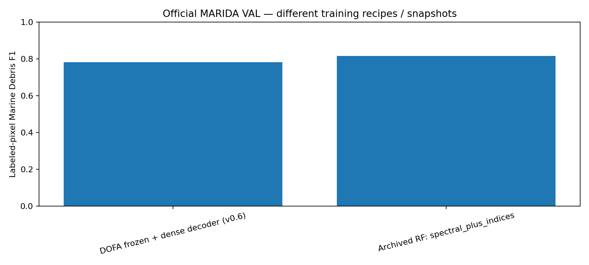
</p>

### Learning curves and class-specific error profile

Training continued for **18 epochs**, with the highest Validation F1 (**0.7813**) at **epoch 10**. Validation F1 subsequently fluctuated while training loss generally decreased. Training loss is weighted, while the recorded validation loss is unweighted; **their absolute values are not directly comparable**.

<p align="center">
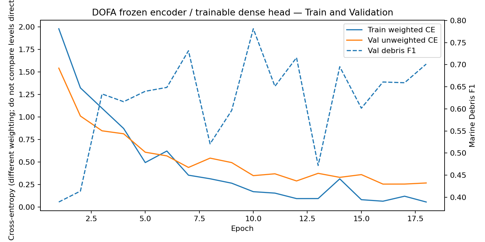
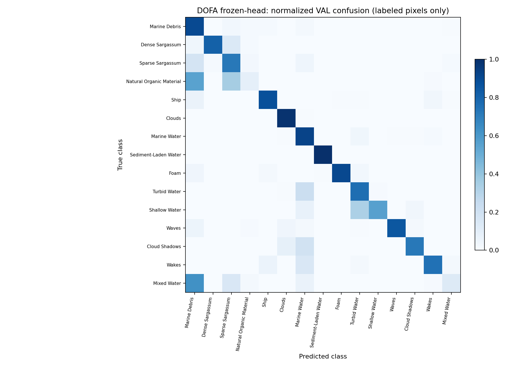
</p>

False-positive Marine Debris predictions come primarily from other surface features:

| True annotated class | Predicted as Marine Debris (FP) |
|:--|--:|
| Ship | **88** |
| Sparse Sargassum | **68** |
| Mixed Water | **59** |
| Natural Organic Material | **51** |
| Waves | **51** |
| Dense Sargassum | 43 |
| Marine Water | 40 |
| Turbid Water | 16 |
| Foam | 15 |
| Wakes | 7 |
| **Clouds** | **0** |
| **Sediment-Laden Water** | **0** |

The remaining annotated classes also contributed **zero** false positives in this run. The absence of **Clouds → Debris** and **Sediment-Laden Water → Debris** confusion applies **only to this official Validation evaluation**; it must not be generalized to Test or unseen regions.

### Representative validation error cases

| Patch | TP | FP | FN | Labeled debris pixels | Observation |
|:--|--:|--:|--:|--:|:--|
| `S2_12-1-17_16PEC_15.tif` | 0 | **52** | 0 | 0 | Largest recorded patch-level FP count |
| `S2_18-1-18_48PZC_23.tif` | 0 | **46** | 0 | 0 | Errors without annotated debris |
| `S2_14-3-20_18QYF_3.tif` | 44 | **44** | 1 | 45 | Correct detections mixed with false alarms |
| `S2_11-6-18_16PCC_51.tif` | 0 | **39** | 0 | 0 | Another debris-negative annotated patch |

The previously problematic sediment patch `S2_11-6-18_16PCC_26.tif` had **112 RF false positives** in the v0.2 visual diagnostic but **zero DOFA false positives** in the current run. This is a **localized observation**, not evidence of a general sediment solution. Several high-FP DOFA patches have no annotated Marine Debris; the unlabeled portions of those images remain unscored.

<p align="center">
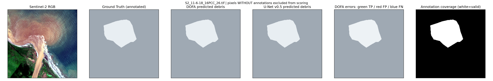
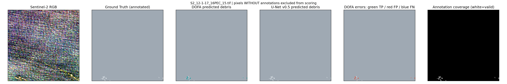
</p>

<details>
<summary><b>View two more DOFA validation case studies</b></summary>

<p align="center">
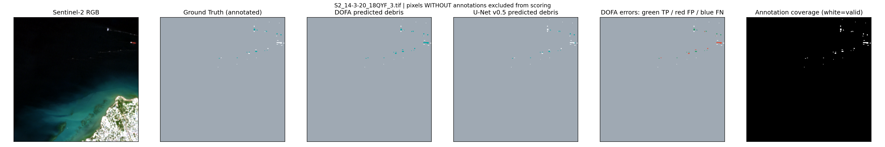
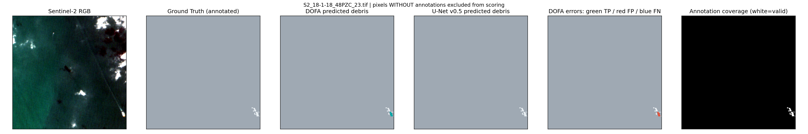
</p>

</details>

### What the DOFA result does—and does not—establish

This is a **successful pretrained-model integration and frozen feature-transfer experiment**, but not an improvement in overall Validation F1 over the existing U-Net or RF baselines. Its different cloud/sediment error profile is informative, but cannot by itself establish a benefit from pretraining, because the decoder also receives the raw spectral bands.

A controlled follow-up should compare **spectral-skip only**, **DOFA tokens only**, and **DOFA tokens + spectral skip** with otherwise matched decoders and validation protocols. If those controls demonstrate value from frozen DOFA features, **adapter / partial-backbone / LoRA tuning** becomes a better-justified next step. Independent geographically disjoint evaluation is still needed to assess transfer outside the familiar Tile IDs.

**Artifacts:** `results/dofa_v06/validation_metrics.csv`, `training_history.csv`, `validation_confusion.csv`, `validation_patch_errors.csv`, `validation_fp_by_true_class.csv`, `validation_model_comparison.csv`, and `run_config.json`; figures in `assets/figures/dofa_v06/`. See [DOFA transfer protocol](docs/dofa_frozen_transfer.md) and [recorded v0.6 research findings](docs/dofa_v06_validation_findings.md).

**Sources:** [DOFA source code](https://github.com/zhu-xlab/DOFA) · [pretrained weights](https://huggingface.co/earthflow/DOFA) · [MARIDA dataset](https://zenodo.org/records/5151941).

## Cross-Experiment Synthesis

The completed experiments support the following bounded conclusions:

- **Spectral indices help the classical baseline on official validation**, but class-specific trade-offs and training-seed sensitivity matter.
- **RF performance on held-out Tile IDs is highly heterogeneous**. A sediment-heavy acquisition within Tile `16PDC` dominates the false-positive burden in the grouped Train-only study.
- **U-Net can eliminate a difficult local sediment false alarm**, but the completed v0.4 U-Net has substantially lower official-test debris F1 than the archived RF and is especially vulnerable to cloud/wave confusions on that split.
- **The controlled v0.5 changes do not improve overall validation F1** beyond the replayed reference, and the highest v0.5 validation score is not evidence of better unseen-area performance.
- **Pretrained DOFA v0.6 was integrated and validated**, with complete verified checkpoint loading and frozen features for 694 Train and 328 Validation patches. Its **0.7813 Validation F1** is below the best previous U-Net and the archived RF, but it shows a different pattern of false positives.
- **A frozen encoder plus raw-spectral skip does not isolate pretraining.** Additional matched controls and independent geographic evaluation are needed before claiming transfer-learning benefits.

The next research milestone is a **controlled contribution-of-pretraining experiment**, followed by geographically independent evaluation and, if supported, parameter-efficient adaptation. These are **future experiments**, not measured v0.6 outcomes.

## Dataset

The [MARIDA benchmark](https://zenodo.org/records/5151941) contains **1,381 Sentinel-2 image patches (256 × 256 pixels)**, **11 spectral bands**, masks with sparse/weak pixel-level annotations for **15 marine classes**, confidence labels, GIS resources, and official split manifests.

The annotated-pixel HDF5 export powers the classical RF experiments. The **U-Net and DOFA feature-extraction pipeline read original multispectral GeoTIFF patches and class/confidence masks**, with training/validation/test identities taken from the official split lists. Missing annotation (`0`) is **excluded from both supervised loss and evaluation**; it is never equated to an ocean-background class.

```text
baseline/data/
├── dataset.h5
├── labels_mapping.txt
├── patches/
│   └── S2_<date>_<tile>/
│       ├── S2_<date>_<tile>_<index>.tif
│       ├── S2_<date>_<tile>_<index>_cl.tif
│       └── S2_<date>_<tile>_<index>_conf.tif
├── shapefiles/
└── splits/
    ├── train_X.txt
    ├── val_X.txt
    └── test_X.txt
```

The actual split totals checked by the v0.4 data script were **694 train**, **328 validation**, and **359 test** patches. The original MARIDA data and trained weights are **not distributed** in this repository; obtain data from [Zenodo](https://zenodo.org/records/5151941). The HDF5–GeoTIFF audit above checks selected spectral signatures, **not independent pixel-coordinate/georeferencing agreement**. See [Dataset/protocol](docs/dataset_and_protocol.md).

## Reproduction

**Working setup:** Windows / PyCharm, Python 3.11 in a Conda environment. The v0.4 GPU diagnostic succeeded on an **NVIDIA GeForce RTX 5070 Laptop GPU** with PyTorch `2.12.0.dev20260408+cu128`, CUDA 12.8, and compute capability `sm_120`. This is a record of the tested environment, **not a recommendation to pin a nightly version**. Install a current compatible PyTorch/CUDA build from [PyTorch's official installer](https://pytorch.org/get-started/locally/) for your GPU and operating system.

The Python scripts are designed for **PyCharm → Run**, without command-line arguments. Install the packages listed in [`requirements.txt`](requirements.txt); HDF5/Pandas needs `tables` (PyTables), and image input/plots need `tifffile`, `numpy`, `pandas`, and `matplotlib`. The U-Net stages additionally require compatible `torch`. For v0.6 DOFA, see [`requirements-dofa.txt`](requirements-dofa.txt) for the additional model dependencies (`timm`, `huggingface_hub`). The recorded weights were obtained using the DOFA upstream source and Hugging Face; initial setup needs internet access, while local cached feature training does not.

### Workflow by stage

| # | Script | Purpose | Main outputs |
|:--|:--|:--|:--|
| 01 | [`01_inspect_dataset.py`](baseline/01_inspect_dataset.py) | Inspect HDF5 splits/class coverage | Dataset summaries |
| 02 | [`02_train_random_forest.py`](baseline/02_train_random_forest.py) | Train two initial RFs | Local `.joblib` files |
| 03 | [`03_evaluate_models.py`](baseline/03_evaluate_models.py) | Validation model selection, archived test evaluation | Confusion/metrics CSVs |
| 04 | [`04_analyze_features.py`](baseline/04_analyze_features.py) | Permutation feature dependence | Feature chart |
| 05 | [`05_analyze_test_errors.py`](baseline/05_analyze_test_errors.py) | Historical RF test error breakdown | FP/FN figures |
| 06 | [`06_visualize_satellite_patch.py`](baseline/06_visualize_satellite_patch.py) | Inspect a multispectral patch | RGB/mask visualization |
| 07 | [`07_visual_error_analysis.py`](baseline/07_visual_error_analysis.py) | Inspect 60 validation patches with RF | `results/visual_analysis/` |
| 08 | [`08_verify_hdf_geotiff.py`](baseline/08_verify_hdf_geotiff.py) | Compare HDF5 and GeoTIFF signatures | `results/data_consistency/` |
| 09 | [`09_feature_ablation.py`](baseline/09_feature_ablation.py) | Retrain six RF feature sets | `results/ablation/` |
| 10 | [`10_compare_ablation_patches.py`](baseline/10_compare_ablation_patches.py) | Compare RF on a sediment-heavy patch | Known-patch error table |
| 11 | [`11_multi_seed_robustness.py`](baseline/11_multi_seed_robustness.py) | Repeat six RFs over five seeds | `results/robustness/` |
| 12 | [`12_analyze_scene_errors.py`](baseline/12_analyze_scene_errors.py) | Scene-level and paired-seed error analysis | Robustness findings/charts |
| 13 | [`13_audit_geographic_tiles.py`](baseline/13_audit_geographic_tiles.py) | Audit class support by geographic Tile ID | `results/geographic_holdout/tile_summary.csv` |
| 14 | [`14_geographic_holdout.py`](baseline/14_geographic_holdout.py) | Leave-one-Tile-out RF evaluation on official Train | Holdout folds/pooled scores |
| 15 | [`15_check_gpu_and_data.py`](baseline/15_check_gpu_and_data.py) | Verify CUDA, GeoTIFF bands/masks and official splits | GPU/data diagnostic log |
| 16 | [`16_train_unet.py`](baseline/16_train_unet.py) | Train v0.4 U-Net, save best validation checkpoint | `models/unet_best.pt`, training curves |
| 17 | [`17_evaluate_unet.py`](baseline/17_evaluate_unet.py) | Evaluate completed v0.4 U-Net | `results/unet/`, prediction maps |
| 18 | [`18_train_unet_v05.py`](baseline/18_train_unet_v05.py) | Train four controlled U-Net variants | `results/unet_v05/`, checkpoints |
| 19 | [`19_analyze_unet_v05.py`](baseline/19_analyze_unet_v05.py) | Compare v0.5 variants on **validation only** | Patch-level diagnostics/figures when executed |
| 20 | [`20_prepare_dofa.py`](baseline/20_prepare_dofa.py) | Verify real DOFA pretrained weights, calculate Train-only statistics, cache frozen tokens for Train/Validation | `baseline/cache/dofa_v06/` |
| 21 | [`21_train_dofa_head.py`](baseline/21_train_dofa_head.py) | Train the dense segmentation decoder; keep DOFA frozen | Local decoder checkpoint, training history |
| 22 | [`22_analyze_dofa.py`](baseline/22_analyze_dofa.py) | Evaluate DOFA on official Validation, make error maps/confusion matrix, compare historical baselines | `results/dofa_v06/`, `assets/figures/dofa_v06/` |

**Execution order:** script 14 follows the Tile audit (13); script 16 follows the GPU diagnostic (15); script 17 follows a successful v0.4 training run (16). **For v0.5 run 18 first, then 19**; the earlier stages do not need to be rerun just to execute these files. Scripts 18–19 do not read official Test. Models used in v0.5 are saved under `models/unet_v05/` and do not overwrite `models/unet_best.pt` from v0.4. **For v0.6, run 20 → 21 → 22**; all three stages are complete in the recorded experiment, and no v0.6 Test result has been generated. DOFA pretrained features and checkpoints stay local and should not be committed.

### Outputs and experiment isolation

| Location | Content |
|:--|:--|
| `results/benchmark/` | Archived v0.1 RF metrics and scores |
| `results/visual_analysis/`, `results/data_consistency/` | v0.2 errors and input verification |
| `results/ablation/`, `results/robustness/` | v0.3 and v0.3.1 RF experiments |
| `results/geographic_holdout/` | v0.3.2 Tile audit, grouped folds and confusion counts |
| `results/unet/` | v0.4 training, validation/test diagnostics and comparisons |
| `results/unet_v05/` | v0.5 controlled runs and **validation-only** evaluation |
| `results/dofa_v06/` | v0.6 verified decoder training and official-Validation metrics / errors |
| `assets/figures/dofa_v06/` | v0.6 learning curves, model comparison, confusion and patch figures |
| `baseline/cache/dofa_v06/` | Large frozen DOFA feature maps; keep out of Git |
| `assets/figures/<stage>/` | Figures suitable for Markdown/GitHub |
| `models/`, `baseline/data/`, `results/runs/latest/` | Local training artifacts and raw data; normally excluded from Git |

The numerical results in this README are **recorded outputs from separate runs**, not a unified lockfile-based re-execution. Save `run_config.json`, training histories, confusion matrices and dataset provenance alongside the relevant experiment. Inspect `.gitignore` before committing: intentional figures and selected small CSV summaries may be tracked, while raw imagery, `.h5` files, and model weights should remain local.

## Repository Layout

```text
MARIDA-SpectralBench/
├── README.md
├── LICENSE
├── requirements.txt
├── requirements-dofa.txt           # Additional DOFA dependencies
├── .gitignore
├── assets/
│   └── figures/
│       ├── benchmark_scores.png
│       ├── visual_errors/
│       ├── data_consistency/
│       ├── ablation/
│       ├── robustness/
│       ├── geographic_holdout/       # Held-out Tile F1 / FP charts
│       ├── unet/                     # Loss, confusion matrices, patch overlays
│       ├── unet_v05/                 # Controlled U-Net learning curves
│       └── dofa_v06/                 # Frozen-DOFA transfer plots and patch overlays
├── baseline/
│   ├── settings.py
│   ├── spectral_features.py
│   ├── unet_core.py               # Shared U-Net architecture and GeoTIFF loader
│   ├── dofa_transfer.py            # DOFA encoder/decoder and cached-feature utilities
│   ├── 01_inspect_dataset.py
│   ├── ...
│   ├── 14_geographic_holdout.py
│   ├── 15_check_gpu_and_data.py
│   ├── 16_train_unet.py
│   ├── 17_evaluate_unet.py
│   ├── 18_train_unet_v05.py
│   ├── 19_analyze_unet_v05.py
│   ├── 20_prepare_dofa.py
│   ├── 21_train_dofa_head.py
│   ├── 22_analyze_dofa.py
│   ├── cache/                      # DOFA feature cache; local only
│   └── data/                      # Local-only official MARIDA input
├── docs/
│   ├── dataset_and_protocol.md
│   ├── experiment_notes.md
│   ├── visual_error_analysis.md
│   ├── data_consistency.md
│   ├── feature_ablation.md
│   ├── robustness_and_scene_analysis.md
│   ├── geographic_holdout.md
│   ├── unet_segmentation.md
│   ├── unet_v05_controlled_ablation.md
│   ├── dofa_frozen_transfer.md
│   └── dofa_v06_validation_findings.md
├── models/                         # Local-only .joblib / .pt checkpoints
├── results/
│   ├── benchmark/
│   ├── visual_analysis/
│   ├── data_consistency/
│   ├── ablation/
│   ├── robustness/
│   ├── geographic_holdout/
│   ├── unet/
│   ├── unet_v05/
│   ├── dofa_v06/
│   └── runs/                      # Local interim run outputs
└── tests/
    └── check_features.py
```

The tree is the **intended local project layout**. Only paths you actually add and commit will appear on GitHub. In particular, generated images referenced above must be committed under the same relative paths for the README previews to render.

## Limitations and Next Steps

The current results constitute a **classical baseline, documented failure analyses, a grouped RF stress test, two generations of U-Net experiments, and a verified pretrained DOFA frozen-transfer experiment**. They do **not** establish a state-of-the-art marine debris detector or reliable transfer to arbitrary unseen coastal waters.

### Interpretation boundaries

- **Sparse labels:** Evaluation is limited to annotated class-1–15 pixels; unlabeled areas are never counted as true negatives. Reported rates are **not full-image debris-detection rates**.
- **Not a controlled architecture-only comparison:** RF with 19 engineered/spectral features and U-Net with 11 raw bands differ in training procedure, sampling, loss, and model family. Their scores describe the tested systems, not a clean causal effect of convolution.
- **Official Test has been seen:** v0.1 RF and v0.4 U-Net Test results are historical reports. Model redesign after inspecting them reduces the independence of that split for later studies. **No v0.5 or v0.6 Test result is claimed.** A new independent or properly pre-registered final evaluation is required for confirmatory conclusions.
- **Geographic independence is approximate:** 5 of the 7 official-validation Tile IDs overlap with Train. The grouped v0.3.2 experiment prevents identical Tile IDs across fit/evaluation folds, but exact footprint nonoverlap has not been audited.
- **Heterogeneous class support:** Some Tiles have almost no annotated debris; pooled and Tile-macro metrics answer different questions and can favor different models.
- **Small robustness samples:** The RF ablation uses five seeds, v0.3.2 uses one seed, and the U-Net experiments reported here use one seed. Their variations are not independent-scene uncertainty estimates.
- **Scene-specific errors:** Large false-positive concentrations in `16PDC`/sediment scenes and v0.4 Test cloud/wave confusions cannot be explained causally from confusion tables alone.
- **Data verification scope:** HDF5–GeoTIFF spectra and labels agreed for 411 sampled records in 3 patches, but exact pixel coordinate and entire-archive agreement remain unverified.
- **Frozen DOFA is not full fine-tuning:** v0.6 keeps the ViT-B encoder fixed. Its decoder receives both pretrained tokens and raw spectral bands; a matched skip-only and token-only ablation is necessary before attributing benefits to pretraining.
- **Pretraining and preprocessing domain mismatch:** the project uses Train-only band normalization, which may differ from the original DOFA pretraining normalization. No normalization-ablation or adapter study has yet been completed.
- **Model artifacts:** Checkpoint files and raw dataset files are local and excluded from version control; a README alone cannot reproduce a run without those inputs and its configuration.

### Next research milestones (not yet completed)

1. **Isolate the role of DOFA pretraining:** train matched decoders using raw spectral skip only, frozen DOFA tokens only, and both inputs. Preserve the same Train/Validation protocol and do not use historical Test for selection.
2. **Evaluate parameter-efficient adaptation if justified:** explore adapter/LoRA or partial-encoder tuning with documented compute cost and pretrained initialization, rather than assuming full fine-tuning must improve performance.
3. **Independent geographic evaluation of selected models:** create a carefully documented spatially disjoint evaluation or acquire independently labeled scenes; verify actual footprints and class support, then compare RF, U-Net and DOFA on the *same* observations.
4. **Repeatability and uncertainty:** repeat promising U-Net/DOFA configurations across multiple seeds and quantify scene-/Tile-aware variability, rather than treating neighboring pixels as independent samples.
5. **Physically interpretable error studies:** analyze sediment, cloud, wave, ship and organic-material confusions with co-registered spectra and annotations before making any mechanistic claim.
6. **Complete optional v0.5 visual diagnostics:** if needed, run script 19 to export per-patch maps for difficult Validation scenes.

The project aims to produce **auditable research evidence**: a higher validation F1 alone is not an assertion of meaningful, independent generalization.

## References

**MARIDA dataset and benchmark**

Kikaki, K., Kakogeorgiou, I., Mikeli, P., Raitsos, D. E., & Karantzalos, K. (2022). *MARIDA: A benchmark for Marine Debris detection from Sentinel-2 remote sensing data*. *PLOS ONE*, 17(1), e0262247. https://doi.org/10.1371/journal.pone.0262247

**Related remote-sensing foundation model research**

Liu, F., et al. (2024). *RemoteCLIP: A Vision Language Foundation Model for Remote Sensing*. *IEEE Transactions on Geoscience and Remote Sensing*. https://doi.org/10.1109/TGRS.2024.3390838

**DOFA pretrained remote-sensing model**

Xiong, Z., et al. (2024). *Neural Plasticity-Inspired Multimodal Foundation Model for Observing the Earth Crossing Modalities*. https://arxiv.org/abs/2403.15356 · [official source](https://github.com/zhu-xlab/DOFA) · [pretrained weights](https://huggingface.co/earthflow/DOFA)

This is an independent benchmark project and is **not affiliated with the MARIDA, DOFA, or RemoteCLIP authors**.

## Maintainer

[Mehdi Hashemi](https://github.com/mehdi-hashemi-01) · [MIT License](LICENSE)
