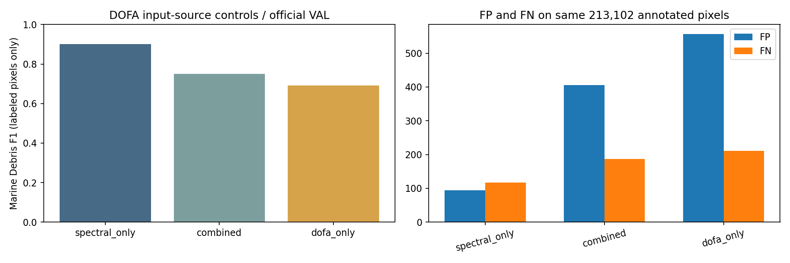
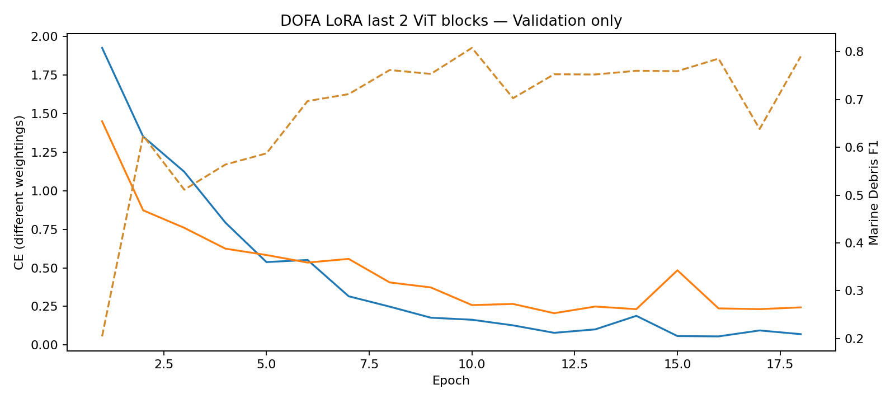
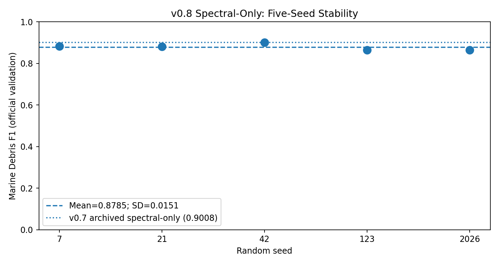
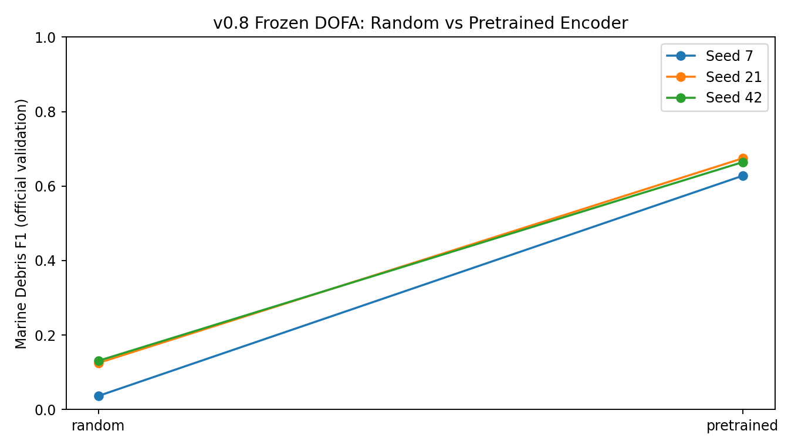

<div align="center">

# MARIDA-SpectralBench

**Marine Debris Segmentation from Multispectral Sentinel-2 Imagery**

*Spectral baselines · U-Net · Remote-Sensing Foundation Models · LoRA · Geographic Generalization*

[](https://www.python.org/)
[](https://pytorch.org/)
[](https://zenodo.org/records/5151941)
[](#v08-reproducibility-and-geographic-generalization)
[](LICENSE)

**An experimental benchmark of what works, what fails, and what transfers to unseen Sentinel-2 Tile IDs.**

[Overview](#overview) · [Key Results](#key-results) · [Experiments](#research-stages) · [v0.8 Results](#v08-reproducibility-and-geographic-generalization) · [Reproduce](#reproduction) · [Limitations](#limitations-and-next-steps)


</div>

## Overview

Floating marine debris is difficult to distinguish from ships, wakes, waves, clouds, sediment-rich water, and naturally occurring organic material. **MARIDA-SpectralBench** studies these confusions using 11-band Sentinel-2 patches and the [MARIDA benchmark](https://zenodo.org/records/5151941). The project moves from pixel-wise Random Forest baselines to multispectral U-Net, a wavelength-aware **DOFA ViT-Base** foundation-model encoder, controlled source ablations, **LoRA**, and grouped geographic evaluation.

The objective is **reproducible, critical model comparison**, not a claim of state-of-the-art accuracy. In particular, the best ordinary validation result is **not** treated as an independent estimate of performance on unseen regions.

### Data and evaluation in brief

| Item | Recorded protocol |
|:--|:--|
| Dataset | MARIDA: 1,381 patches, each 256 × 256 pixels, 11 Sentinel-2 bands |
| Official partition | **694 Train / 328 Validation / 359 Test** patches |
| Prediction task | 15-class semantic segmentation; Marine Debris is the primary target class |
| Labeled Validation pixels | 213,102, including 1,075 Marine Debris pixels |
| Labeled Train pixels | 429,412, including 1,943 Marine Debris pixels |
| Unlabeled pixels | Mask value **0**; ignored in loss and *all* reported metrics |
| Primary metric | Pooled **Marine Debris F1** on annotated pixels; also precision, recall, IoU, FP/FN |

**Evaluation scopes are intentionally different:** official Validation is used for checkpoint selection; the original official Test was inspected in historical v0.1/v0.4 experiments; v0.8 geographic results are from **leave-one-Tile-ID-out evaluation within official Train**. Do not compare these scores as if they came from one independent test set.

## Key Results

### Model comparison on official Validation

| Model / experiment | Marine Debris F1 | Precision | Recall | Protocol |
|:--|--:|--:|--:|:--|
| **v0.7 Spectral-only convolutional decoder** | **0.9008** | **0.9106** | 0.8912 | Best of one run; later replicated across five seeds |
| v0.5 U-Net, reference replay | 0.8286 | 0.8123 | 0.8456 | Separate training recipe |
| v0.1 RF, 19 spectral/derived features | 0.8157 | 0.7475 | 0.8977 | Archived spectral baseline |
| v0.7 DOFA + LoRA + spectral skip | 0.8077 | 0.7617 | 0.8595 | LoRA in final two attention blocks |
| v0.4 U-Net | 0.8009 | 0.7577 | 0.8493 | Separate training recipe |
| v0.6 Frozen DOFA + spectral skip | 0.7813 | 0.6889 | 0.9023 | Pretrained encoder frozen |
| v0.7 Frozen DOFA + spectral skip | 0.7497 | 0.6862 | 0.8260 | Controlled source-ablation training run |
| v0.7 Frozen DOFA tokens only | 0.6923 | 0.6080 | 0.8037 | High-resolution spectral skip disabled |

The `spectral_only` model is a **small spatial convolutional segmentation decoder** receiving the original 11 bands; it is **not** the 11-band Random Forest. Its high score is an exploratory Validation result, repeatedly used for model development, not an independent new-region performance claim.

### Three v0.8 findings

| Research question | Recorded result | Interpretation |
|:--|:--|:--|
| Is the best spectral-only model repeatable? | **0.8785 ± 0.0151** F1 over five seeds | Variation between fitting seeds on the *same* official Validation split |
| Which segmentation model transfers better across held-out Tile IDs? | **Spectral Only: 0.6089** pooled F1 (13 folds) | Leads the three tested systems on this grouped *Train-only* protocol |
| Do pretrained DOFA features outperform random DOFA features? | **0.6555 vs 0.0973** mean Validation F1 over three paired decoder seeds | Clear conditional benefit of DOFA pretraining with a frozen DOFA-only encoder |

These experiments answer **different questions**. In particular, pretraining helps relative to an untrained DOFA backbone under the matched frozen-feature protocol, **even though** the pretrained DOFA systems do not beat the high-resolution spectral-only decoder in the recorded comparisons.

## Research Stages

| Stage | Experiment | Status |
|:--|:--|:--|
| v0.1 | Random Forest: original 11 bands versus 11 bands + 8 indices | Completed |
| v0.2 | Patch-level visual errors and sampled HDF5–GeoTIFF consistency check | Completed |
| v0.3 | Six-way retrained spectral feature ablation | Completed |
| v0.3.1 | Five-seed RF robustness and acquisition-group error analysis | Completed |
| v0.3.2 | Leave-one-Tile-ID-out Random Forest, official Train only | Completed |
| v0.4 | 11-band, 15-class U-Net | Completed |
| v0.5 | Four controlled U-Net training ablations | Completed on Validation |
| v0.6 | Pretrained DOFA frozen-feature segmentation | Completed on Validation |
| v0.7 | DOFA input-source ablations and LoRA adaptation | Completed on Validation |
| **v0.8** | **Five-seed reproducibility, nested 13-Tile holdout, pretrained-vs-random DOFA** | **All three experiments completed** |

Detailed historical methods are preserved in [`docs/`](docs/); the central findings and current reproducibility instructions follow.

## Spectral Baselines and Failure Analysis (v0.1–v0.3.2)

### Classical Random Forest

The initial RF used **100 trees**, seed **42**, up to **2,000 sampled training pixels per class**, and MARIDA annotation-confidence sample weights. Engineered features (NDVI, FAI, FDI, SI, NDWI, NRD, NDMI, BSI) were calculated from the same original 11 bands, not from additional imagery.

| Feature set / split | Marine Debris F1 | Precision | Recall | IoU |
|:--|--:|--:|--:|--:|
| 11 bands — official Validation | 0.7957 | 0.7151 | 0.8967 | 0.6607 |
| **19 features — official Validation** | **0.8157** | 0.7475 | 0.8977 | 0.6888 |
| 19 features — **historical official Test** | **0.6779** | 0.5261 | 0.9528 | 0.5127 |

The RF historical Test evaluation had **363 TP, 327 FP, and 18 FN**. Wave, cloud, and ship pixels were prominent sources of mistaken debris predictions. The historical Test was subsequently inspected; later experiments **do not** treat it as a pristine confirmation set.

<p align="center"></p>

### What the RF ablations revealed

A one-seed retraining of six feature sets showed the highest Validation F1 with all **19 features (0.8187)**. A separate **5-seed × 6-feature-set** study found a full-feature mean F1 of **0.8232** (sample SD **0.0107**); removing NDWI lowered F1 in all five paired seed comparisons. Removing NDWI could reduce sediment false positives in some seeds while increasing total FP/FN across the full split.

The 60-patch v0.2 visual subset had **156 FP**, **112** of which came from one high-confidence, sediment-laden-water patch (`S2_11-6-18_16PCC_26.tif`). The sampled HDF5/GeoTIFF audit matched spectral signatures and labels for **411 records in three patches** without rescaling; **raster coordinate/georeferencing correspondence was not independently verified**.

<p align="center">


</p>

### Earlier RF grouped holdout: a different protocol

A separate v0.3.2 study used **13 held-out Tile IDs from official Train** and found a pooled RF debris F1 of **0.3018** for all 19 features, versus **0.3504** without NDWI. One held-out Tile (`16PDC`) accounted for **5,194 of 7,278** full-model false positives. This experiment has its own RF sampling and fitting protocol and **must not** be presented as a directly controlled comparison with the v0.8 neural holdout scores.

Further detail: [feature ablations](docs/feature_ablation.md) · [RF robustness](docs/robustness_and_scene_analysis.md) · [geographic RF evaluation](docs/geographic_holdout.md) · [visual error cases](docs/visual_error_findings.md).

## Multispectral U-Net (v0.4–v0.5)

The v0.4 model is a lightweight **11-input-channel, 15-class U-Net**, trained from scratch with masked cross-entropy, Train-only band statistics, confidence/class weights, geometric augmentation, debris-positive patch oversampling and validation-based checkpoint selection. It reached **0.8009 Validation F1** at epoch 33. Its **historical official Test F1 was 0.3851** (315 TP, 940 FP, 66 FN), lower than the archived RF on that Test population. This does not isolate an architectural effect because the systems have different features and objectives.

Four freshly trained v0.5 variants tested the earlier training choices:

| U-Net v0.5 configuration | Best epoch | Validation F1 | TP | FP | FN |
|:--|--:|--:|--:|--:|--:|
| **Reference replay** | **33** | **0.8286** | 909 | 210 | 166 |
| No class-frequency weights | 22 | 0.8203 | 931 | 264 | 144 |
| No debris-positive oversampling | 22 | 0.8224 | 873 | **175** | 202 |
| Additional spectral jitter | 4 | 0.6462 | 799 | 599 | 276 |

None of the three changes improved F1 over the v0.5 reference. No v0.5 Test score is claimed. See [U-Net protocol](docs/unet_segmentation.md) and [training ablations](docs/unet_v05_controlled_ablation.md).

<p align="center"></p>

## DOFA Foundation-Model Transfer and LoRA (v0.6–v0.7)

### Verified DOFA weights and input representation

The [DOFA](https://github.com/zhu-xlab/DOFA) ViT-Base encoder accepts the 11 Sentinel-2 bands together with their wavelengths. The verified, officially pretrained checkpoint is `DOFA_ViT_base_e100.pth`:

```text
Checkpoint SHA256:
4720985e42b918ac0307009eb06121a3435d9bbce6fd95446f84824a538165b1
Pretrained tensor coverage: 100.00%
Cached frozen features: 694 Train + 328 Validation patches
```

Its dense tokens form a **16 × 16** grid for a **256 × 256** input image. A trainable segmentation decoder upsamples these features to pixel predictions, optionally using a high-resolution **11-band spectral skip connection**. Version v0.6 used both sources with a fixed encoder and reached **0.7813 official-Validation F1** (970 TP, 438 FP, 105 FN). The raw skip makes it impossible to attribute that score solely to pretrained tokens.

### v0.7: source-controlled decoder experiments

Three fresh, seed-42 models used the **same decoder architecture and training settings**; only the information source changed. The unavailable source was replaced by zeros rather than removing decoder parameters.

| Input to the decoder | Validation F1 | Precision | Recall | TP / FP / FN |
|:--|--:|--:|--:|:--|
| **Spectral-only: 11 raw bands; DOFA features zeroed** | **0.9008** | **0.9106** | 0.8912 | 958 / 94 / 117 |
| DOFA + raw spectral skip | 0.7497 | 0.6862 | 0.8260 | 888 / 406 / 187 |
| DOFA tokens only; raw spectral skip zeroed | 0.6923 | 0.6080 | 0.8037 | 864 / 557 / 211 |

In this particular fusion head, **frozen DOFA tokens did not improve the score over the spectral-only input**. The high-resolution spectral branch contains spatial information through the decoder's `3×3` convolutions. Input-source ablation does **not** answer whether *pretraining* helps relative to a random DOFA backbone: that separate question is addressed in **v0.8**.

<p align="center"></p>

### v0.7: parameter-efficient adaptation

A separate experiment placed **rank-4, alpha-8 LoRA** adapters on the `qkv` and `proj` layers of the **final two DOFA attention blocks**, training **36,864 adapter parameters** and **133,151 decoder parameters**, while leaving all original DOFA weights frozen. This system reached **0.8077 Validation F1** (924 TP / 289 FP / 151 FN).

Its score is higher than the separately trained frozen combined model (**0.7497**), but these training runs differ in batch size, learning rates and trainable-parameter counts: the difference is **not a clean causal estimate of LoRA's contribution**. The adapted system also trails the spectral-only decoder on Validation. See [v0.6 protocol](docs/dofa_frozen_transfer.md), [v0.7 experiment design](docs/dofa_v07_controls_and_lora.md), and [v0.7 findings](docs/dofa_v07_findings.md).

<p align="center"></p>

## v0.8 Reproducibility and Geographic Generalization

Version v0.8 contains **three completed experiments**, each with a distinct evaluation purpose. The official Test is not accessed in any of them.

### A. Five-seed stability of the spectral-only decoder

The same official **694 Train / 328 Validation** patches were used with decoder/training seeds **42, 7, 21, 123 and 2026**. Each model's best checkpoint was selected on official Validation F1.

| Training seed | Best epoch | Debris F1 | Precision | Recall |
|--:|--:|--:|--:|--:|
| 42 | 23 | **0.9008** | 0.9106 | 0.8912 |
| 7 | 17 | 0.8822 | 0.8506 | **0.9163** |
| 21 | 23 | 0.8808 | 0.8587 | 0.9042 |
| 123 | 8 | 0.8642 | 0.8389 | 0.8912 |
| 2026 | 12 | 0.8645 | 0.8402 | 0.8902 |
| **Mean ± sample SD** | — | **0.8785 ± 0.0151** | — | — |

All five fitted models exceed **0.864** on the same Validation population. **SD here is between-seed variability, not a confidence interval for new regions.** The best seed-42 score should not stand alone as the expected performance.

<p align="center"></p>

### B. Nested 13-fold leave-one-Tile-ID-out comparison

The **694 official Train patches** were grouped into **13 Tile IDs**. In each fold, the outer Tile was completely excluded from fitting and *checkpoint selection*. Among the remaining Tiles, a **Date+Tile-group-disjoint internal validation** selected the best epoch. Training normalization statistics, class weights, and frozen DOFA feature caches were recomputed from that fold's inner-fitting data. Each patch received exactly **one outer-fold prediction per model**.

Three neural methods were evaluated on **identical outer Tiles** (seed **42**): `spectral_only`, 11-band `unet`, and frozen pretrained `dofa_combined` with spectral skip. Although the split design is matched, model architectures and capacities are not.

| Model | Pooled debris F1 | Precision | Recall | IoU | TP | FP | FN | Tile-macro F1* |
|:--|--:|--:|--:|--:|--:|--:|--:|--:|
| **Spectral-only decoder** | **0.6089** | **0.5565** | 0.6722 | **0.4377** | 1,306 | **1,041** | 637 | **0.5529** |
| Frozen DOFA + spectral skip | 0.4232 | 0.2951 | **0.7478** | 0.2684 | **1,453** | 3,470 | **490** | 0.4213 |
| U-Net (11 bands) | 0.2716 | 0.1949 | 0.4478 | 0.1571 | 870 | 3,594 | 1,073 | 0.2105 |

<small>*Tile-macro F1 is averaged over the **10** Tile IDs containing at least one annotated Marine Debris pixel. The three debris-absent Tiles are excluded from this macro average, but their false positives remain included in pooled metrics.</small>

Every row pools **429,412 labeled pixels**, including **1,943 annotated Marine Debris pixels**. A different degree of geographic difficulty and positive-class support is visible by Tile:

| Held-out Tile | Annotated debris pixels | Spectral-only F1 | DOFA + skip F1 |
|:--|--:|--:|--:|
| `18QYF` | 606 | **0.8773** | 0.5110 |
| `16PCC` | 841 | **0.4967** | 0.4164 |
| `16PDC` | 67 | **0.6165** | 0.3583 |
| `48MXU` | 208 | 0.8320 | **0.9718** |
| `30VWH` | 27 | 0.0667 | 0.0000 |
| `52SDD` | 4 | 0.0816 | 0.0288 |

**Interpretation.** Spectral Only leads the pooled grouped comparison, but DOFA performs better in at least one held-out Tile (`48MXU`). Small-support Tiles produce unstable per-Tile F1 values. In the Spectral-only model, the largest held-out false-positive sources include **Ship (206)**, **Natural Organic Material (189)**, **Clouds (188)**, **Waves (159)** and **Wakes (135)**; **456 true debris pixels were predicted as Ship**.

The grouped test is a useful **Tile-ID generalization stress test**, not yet a verified spatial-footprint-independent external test. The difference between its F1 and earlier official-Validation F1 also reflects different fitting populations and validation-selection protocols, so it cannot be attributed **solely** to geographic shift.

<p align="center"></p>

### C. Pretrained versus randomly initialized frozen DOFA

This **direct pretraining control** holds the DOFA ViT-Base architecture, 11-band preprocessing, training/validation identities, **frozen encoder state**, DOFA-only decoder architecture, loss/sampling and the **zeroed raw-spectral skip** fixed. The treatment is the **encoder initialization**: genuine pretrained weights versus `pretrained=False` random weights. The same three decoder seeds (**7, 21, 42**) are used in both conditions.

| Decoder seed | Pretrained DOFA F1 | Random DOFA F1 | Paired improvement |
|--:|--:|--:|--:|
| 7 | 0.6276 | 0.0363 | **+0.5914** |
| 21 | 0.6745 | 0.1249 | **+0.5496** |
| 42 | 0.6643 | 0.1306 | **+0.5337** |
| **Mean** | **0.6555** | **0.0973** | **+0.5582** |

The paired improvement has sample SD **0.0298** across the three decoder seeds. The pretrained checkpoint is the verified v0.6 SHA256 above; the random encoder has a separately recorded initialization fingerprint (`1255b8cfda921928586f48b67aeb0f5ea5a8706394c672420b0143e05d8418ad`). **The same random encoder initialization is used across all three pairs**, so the experiment does not estimate variation across independently reinitialized random backbones.

**Finding:** Under a fixed DOFA-only frozen-feature setup, pretrained DOFA representations are substantially more useful than those from an untrained DOFA encoder. This is compatible with the earlier finding that the tested *fusion* of frozen DOFA features and the high-resolution spectral skip does not outperform the spectral-only decoder. **Pretraining value and full-system performance are separate questions.** Checkpoints were selected with the same official Validation split used for scoring; no independent Test result is claimed.

<p align="center"></p>

**v0.8 evidence files:** [empirical geographic/seed findings](docs/v08_empirical_findings.md) · [pretraining-control analysis](docs/v08_pretraining_control_findings.md) · [technical report](docs/MARIDA_v08_technical_research_report.md) · [experimental protocol](docs/v08_reproducibility_and_geographic_protocol.md).

## Cross-Experiment Interpretation

The v0.8 evidence supports two complementary conclusions: **high-resolution spectral information performs strongly in the tested segmentation decoder**, and **remote-sensing pretraining contributes useful frozen features compared with random initialization**. The tested DOFA feature fusion, however, has not demonstrated a general advantage over the spectral-only decoder. LoRA offers an additional adaptation option but was not isolated with a strict on/off controlled optimization comparison.

Geographic grouped evaluation reveals substantially weaker pooled performance than the best official Validation score, and performance is highly variable across Tiles. The most defensible project outcome is therefore an **auditable comparison of approaches and failure modes under explicit evaluation protocols**, rather than a headline accuracy claim.

## Reproduction

### Environment and data

The recorded experiments used **Windows + PyCharm + Python 3.11**, an **NVIDIA RTX 5070 Laptop GPU**, and CUDA-enabled PyTorch. A recorded working build was `2.12.0.dev20260408+cu128` (CUDA 12.8); this identifies the experiment environment, **not** a recommendation to install that nightly build. Choose a compatible PyTorch release using the [official installer](https://pytorch.org/get-started/locally/).

Install the project dependencies from `requirements.txt`, plus `requirements-dofa.txt` for DOFA (`timm` and `huggingface_hub`). Download MARIDA from [Zenodo](https://zenodo.org/records/5151941) and keep raw imagery and HDF5 files in `baseline/data/`. Do not commit model checkpoints, caches, or MARIDA raw data.

The scripts run from **PyCharm → Run**, with configuration constants near the top; command-line arguments are not necessary. Prior stages should not be repeated merely to reproduce a completed later-stage analysis when their caches and checkpoints remain available.

### Script map

| Stage | Scripts | Purpose |
|:--|:--|:--|
| Dataset and RF | `01`–`05` | Data inspection, RF baselines and historical Test analysis |
| Visual audit | `06`–`08` | Patch visualization, RF error analysis, sampled HDF5–GeoTIFF checks |
| Feature ablation | `09`–`10` | Six RF feature configurations and difficult-patch comparison |
| RF robustness | `11`–`12` | Five seeds, scene-/acquisition-group diagnostics |
| RF Tile holdout | `13`–`14` | Train-only Tile audit and grouped RF evaluation |
| U-Net v0.4 | `15`–`17` | GPU/data diagnostic, U-Net training, evaluation |
| U-Net v0.5 | `18`–`19` | Training-choice ablations and Validation-only analysis |
| DOFA v0.6 | `20`–`22` | Pretrained-feature cache, decoder training, error analysis |
| DOFA v0.7 | `23`–`26` | Three source ablations, LoRA adaptation and evaluation |
| **v0.8 multi-seed** | [`27_multiseed_spectral_v08.py`](baseline/27_multiseed_spectral_v08.py) | Five independent spectral-decoder fits |
| **v0.8 Tile holdout** | [`28_tile_holdout_v08.py`](baseline/28_tile_holdout_v08.py) | Thirteen nested Tile-ID outer folds × three models |
| **v0.8 pretraining control** | [`29_random_dofa_control_v08.py`](baseline/29_random_dofa_control_v08.py) | Three matched frozen pretrained/random DOFA decoder-seed pairs |
| **v0.8 report** | [`30_research_report_v08.py`](baseline/30_research_report_v08.py) | Generate technical report from completed CSV/JSON artifacts |

For v0.8 run the CPU smoke test (`tests/test_v08_cpu_smoke.py`) before executing `27 → 28 → 29 → 30` when starting a fresh experimental environment. The **research results linked here are already completed recordings**; rerunning them is only necessary to verify or reproduce the computations.

### Repository structure

```text
MARIDA-SpectralBench/
├── README.md
├── LICENSE
├── requirements.txt
├── requirements-dofa.txt
├── baseline/
│   ├── settings.py
│   ├── spectral_features.py
│   ├── unet_core.py
│   ├── dofa_transfer.py
│   ├── dofa_v07_common.py
│   ├── dofa_lora_v07.py
│   ├── v08_research_core.py
│   ├── 01_inspect_dataset.py ... 30_research_report_v08.py
│   ├── data/                    # Local-only MARIDA files
│   └── cache/                   # Local-only pretrained/random feature maps
├── assets/figures/
│   ├── ablation/  robustness/  geographic_holdout/
│   ├── visual_errors/  unet/  unet_v05/
│   ├── dofa_v06/  dofa_v07/  v08/
│   └── pipeline.png
├── docs/                        # Protocols, findings and technical report
├── results/
│   ├── benchmark/  ablation/  robustness/  geographic_holdout/
│   ├── unet/  unet_v05/  dofa_v06/  dofa_v07/
│   └── v08/
│       ├── multiseed/
│       ├── geographic/
│       └── pretraining_control/
├── models/                      # Local-only training checkpoints
└── tests/
    └── test_v08_cpu_smoke.py
```

`baseline/data/`, `baseline/cache/`, `models/`, and generated large intermediate tensors should be excluded with `.gitignore`. Track only source code, essential configurations, selected lightweight summary results, reproducibility documentation, and publication-ready figures. The tree is a **reference layout**; a path becomes visible on GitHub only after its files are actually committed.

### Results and provenance

| Results directory | Recorded evidence |
|:--|:--|
| [`results/v08/multiseed/`](results/v08/multiseed/) | Per-seed Validation metrics, summary and protocol |
| [`results/v08/geographic/`](results/v08/geographic/) | Per-fold metrics, pooled confusion matrices, protocol and completion audit |
| [`results/v08/pretraining_control/`](results/v08/pretraining_control/) | Paired pretrained/random metrics, per-run reports and initialization fingerprints |
| [`assets/figures/v08/`](assets/figures/v08/) | Three v0.8 publication-ready comparison figures |
| [`docs/MARIDA_v08_technical_research_report.md`](docs/MARIDA_v08_technical_research_report.md) | Structured English scientific report based on actual artifacts |

All numerical v0.8 outcomes in this README are from recorded CSV and JSON artifacts; the available files are **not evidence that source and data can be independently re-executed without their local datasets and checkpoints**. Checkpoint selection and held-out evaluation boundaries are documented separately for each protocol.

## Limitations and Next Steps

**Do not collapse Validation, historical Test, and grouped Train-only holdout into one leaderboard.** Most model development repeatedly consulted official Validation. The official Test was previously opened for v0.1/v0.4 analysis, and therefore is not a newly pristine confirmatory test for the models designed afterward.

- **Sparse annotation:** `mask=0` is unknown, not a verified negative. Pixel counts and false-alarm rates refer only to annotated regions.
- **Tile identifier versus geography:** each v0.8 held-out Tile ID is absent from fitting, but exact geographic-footprint nonoverlap was not independently audited.
- **Different comparison protocols:** RF, U-Net, frozen DOFA and LoRA have different architectures, inputs, and training budgets; only specifically matched controls support narrowly isolated comparisons.
- **Small and unequal Tile supports:** three Tiles have no labeled debris; several others have very few positives. Positive-class per-Tile F1 may be undefined or unstable.
- **Uncertainty scope:** five decoder seeds measure repeatability on one Validation population; the pretraining study uses three decoder seeds but only **one fixed random backbone initialization**. Neither is a confidence interval for future regions.
- **Foundation-model preprocessing:** Train-only Sentinel-2 normalization and the 16 × 16 token resolution may differ from DOFA's original training assumptions. Their influence has not been isolated.
- **Avoid extrapolation:** zero FP for one class or one image does not prove reliable false-alarm control on new scenes.

**Priorities for a more publishable study:** (1) independently audit geospatial footprints and prevent spatial overlap; (2) obtain a prospectively defined, independently annotated geographic evaluation set; (3) repeat grouped neural evaluation over multiple seeds and report Tile-/scene-aware uncertainty; (4) test several random backbone initializations and a carefully matched LoRA-on/off comparison; (5) analyze ship/debris and organic-material confusions using verified, co-registered spectra. Until then, frame the project as **rigorous exploratory benchmarking and transfer analysis**, not verified external generalization.

## References

1. Kikaki, K., Kakogeorgiou, I., Mikeli, P., Raitsos, D. E., & Karantzalos, K. (2022). **MARIDA: A benchmark for Marine Debris detection from Sentinel-2 remote sensing data.** *PLOS ONE*, 17(1), e0262247. https://doi.org/10.1371/journal.pone.0262247
2. Xiong, Z., et al. (2024). **Neural Plasticity-Inspired Multimodal Foundation Model for Observing the Earth Crossing Modalities.** https://arxiv.org/abs/2403.15356 · [DOFA code](https://github.com/zhu-xlab/DOFA) · [weights](https://huggingface.co/earthflow/DOFA)
3. Roberts, D. R., et al. (2017). **Cross-validation strategies for data with temporal, spatial, hierarchical, or phylogenetic structure.** *Ecography*, 40, 913–929. https://doi.org/10.1111/ecog.02881
4. Hu, E. J., et al. (2021). **LoRA: Low-Rank Adaptation of Large Language Models.** https://arxiv.org/abs/2106.09685

The project is independent and **not affiliated** with the MARIDA or DOFA creators. Results should be cited with their evaluation protocols rather than as a single test leaderboard.

## Maintainer

[Mehdi Hashemi](https://github.com/mehdi-hashemi-01) · [MIT License](LICENSE)
