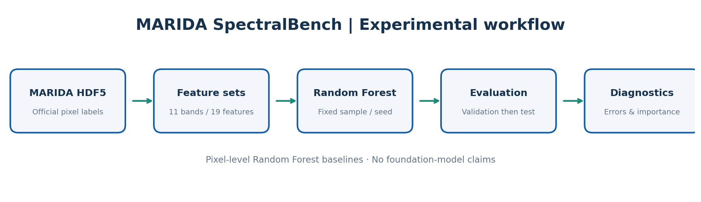
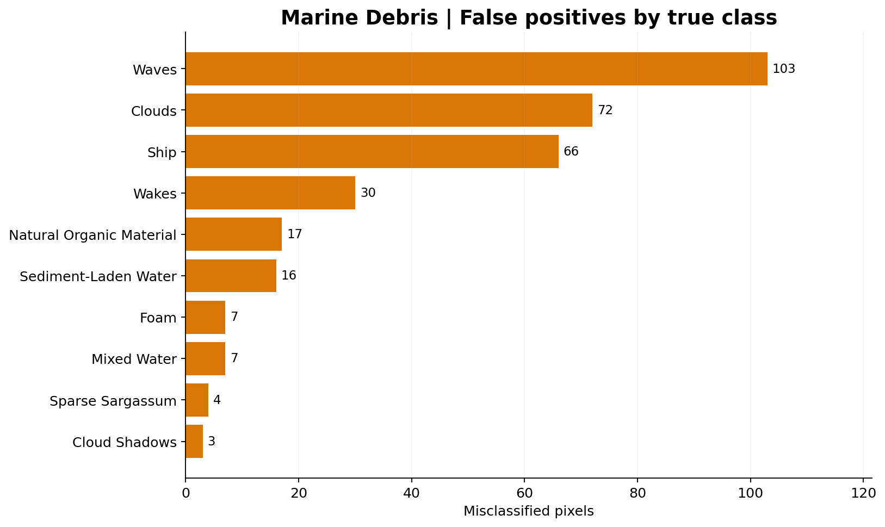
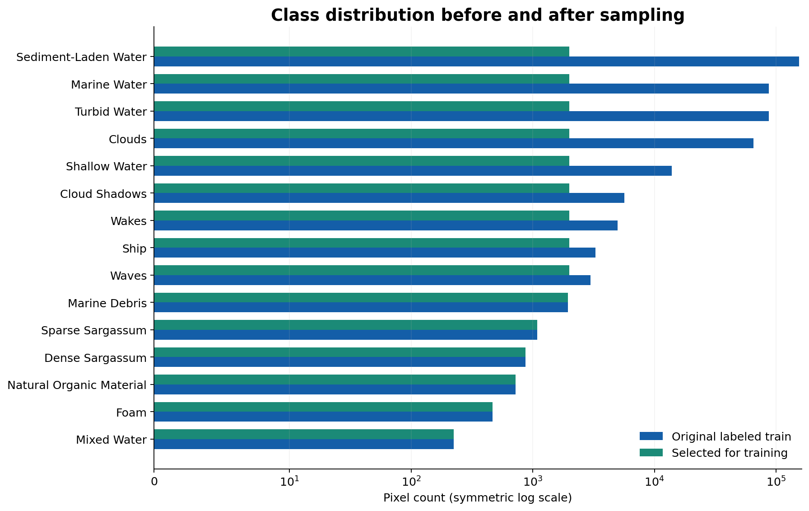
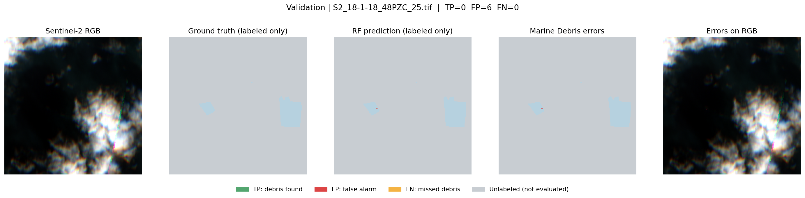
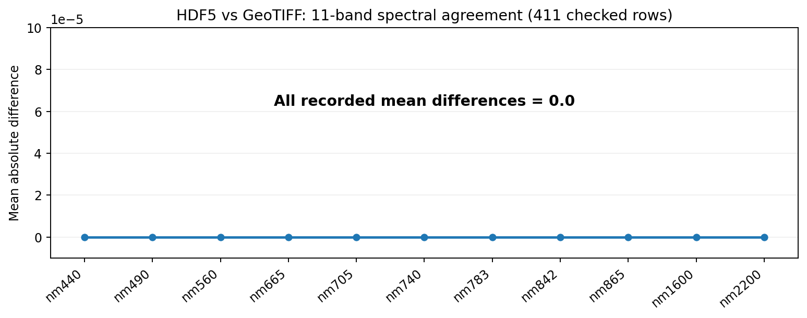

<div align="center">

# MARIDA-SpectralBench

**Spectral Feature Engineering, Benchmarking, and Visual Error Analysis for Marine Debris Detection**

Reproducible pixel-level classification experiments on Sentinel-2 multispectral imagery using the MARIDA benchmark.

[](https://www.python.org/)
[](https://zenodo.org/records/5151941)
[](LICENSE)
[](#validation-patch-level-error-analysis)

[Overview](#overview) · [Benchmark](#benchmark-results) · [Visual Errors](#validation-patch-level-error-analysis) · [Data Verification](#hdf5geotiff-consistency-check) · [Reproduce](#reproduction) · [References](#references)



</div>

## Overview

Detecting floating marine debris in satellite imagery is challenging because debris may be confused with sediment-laden water, waves, clouds, vessels, organic matter, and other surface phenomena. This repository investigates the strengths and limitations of pixel-level spectral classification on [MARIDA](https://zenodo.org/records/5151941), with an emphasis on **reproducible baselines and observable failure cases**.

The current work includes:

- **Spectral baseline:** Random Forest trained on 11 Sentinel-2 spectral bands.
- **Feature engineering:** A second Random Forest using the same bands plus NDVI, FAI, FDI, SI, NDWI, NRD, NDMI, and BSI (19 features in total).
- **Quantitative evaluation:** Class-level F1, IoU, precision, recall, confusion matrices, and error counts.
- **Feature dependence:** Permutation-based sensitivity analysis on validation observations.
- **Visual error analysis:** Georeferenced image patches displayed alongside annotated class masks, model predictions, and localized errors.
- **Input consistency:** Checks of HDF5 spectral records against the corresponding GeoTIFF signatures and annotated class masks.

**Scope.** The implemented models are classical pixel classifiers, not full-image semantic segmentation networks, multimodal vision-language systems, or foundation models. Engineered spectral indices are functions of the input bands and do not constitute an independent data modality.

### Results at a glance

| Evaluation | Marine Debris F1 | Precision | Recall | Observations |
|:--|--:|--:|--:|:--|
| Complete validation — spectral-only RF | 0.7957 | 0.7151 | 0.8967 | Official labeled-pixel split |
| Complete validation — spectral + indices RF | **0.8157** | **0.7475** | 0.8977 | Selected model |
| Held-out test — selected RF | **0.6779** | 0.5261 | **0.9528** | Official labeled-pixel split |
| Visual analysis — 60 validation patches | 0.5561 | 0.4113 | 0.8583 | Diagnostic subset only; **not** the full validation split |

The diagnostic subset is not a new benchmark score and should **not** be directly compared with complete-split scores as if it covered the same observations.

## Benchmark Results

The recorded baseline experiment uses **100 trees**, random seed **42**, and a limit of **2,000 training pixels per class**. Training examples are sampled exclusively from the training split; both feature groups use the same sampled pixels. Sample weights reflect MARIDA annotation confidence. Models are compared on validation Marine Debris F1, and the selected model is evaluated once on the held-out test partition.

| Split | Model | Marine Debris F1 ↑ | IoU ↑ | Precision ↑ | Recall ↑ | Macro F1 ↑ |
|:--|:--|--:|--:|--:|--:|--:|
| Validation | Spectral-only RF | 0.7957 | 0.6607 | 0.7151 | 0.8967 | 0.4809 |
| Validation | Spectral + indices RF | **0.8157** | **0.6888** | **0.7475** | **0.8977** | **0.5546** |
| Held-out test | Selected spectral + indices RF | **0.6779** | **0.5127** | **0.5261** | **0.9528** | **0.5002** |

<p align="center">

</p>

Adding engineered indices improves **validation** Marine Debris F1 by **2.00 percentage points**, IoU by **2.81 percentage points**, and macro F1 by **7.37 percentage points**. Test Marine Debris F1 is **13.79 percentage points** below validation F1. A change in class prevalence and scene composition may contribute; the difference alone does not establish overfitting.

### Held-out test: where the classifier struggles

The selected classifier produced **363 true positives (TP), 327 false positives (FP), and 18 false negatives (FN)** for Marine Debris on the full test split. Its high debris recall (0.9528) is accompanied by substantially lower precision (0.5261).

<p align="center">

</p>

Wave, cloud, and ship pixels are the main sources of test-set false-positive debris predictions.

<details>
<summary><b>View test F1 by class and normalized confusion matrix</b></summary>

<p align="center">


</p>

</details>

### Training data and sampling

The original training split contains **429,412 labeled pixels**; **23,320** were retained for model fitting. Classwise sampling reduces computational cost but changes the class proportions observed during training.

<p align="center">

</p>

### Spectral feature dependence

<p align="center">

</p>

Permuting **NDMI**, **NDWI**, and **FDI** produced the largest positive reductions in Marine Debris F1 on the sampled validation data. These scores indicate **model dependence**, not causal importance or mechanistic interpretability. Related spectral bands and indices are correlated; rankings can change with sample selection and perturbations. A negative importance value means that shuffling the feature improved the score on that particular sample.

## Validation Patch-Level Error Analysis

To inspect *where* classification mistakes occur, the selected `spectral_plus_indices` Random Forest was applied to **60 validation GeoTIFF patches**, and predictions were compared against their corresponding class masks. The visualization includes satellite RGB composites, annotated ground truth, model predictions, error maps, and overlays.

**Evaluation rule:** Metrics and error maps are computed from **annotated pixels only**. Unlabeled pixels are not assumed to be clean water, background, or negatives. The RGB composites are intended for human inspection; the classifier uses the 11-band spectral measurements, not the rendered RGB image.

### Diagnostic subset results

| Metric | Value |
|:--|--:|
| Inspected validation patches | 60 |
| Evaluated labeled pixels | 102,285 |
| Marine Debris true positives | 109 |
| Marine Debris false positives | 156 |
| Marine Debris false negatives | 18 |
| Marine Debris precision | 0.4113 |
| Marine Debris recall | 0.8583 |
| Marine Debris F1 | 0.5561 |

These figures pool labeled-pixel counts across the inspected patches; they are **not** the mean of per-patch F1 values. Patches with no positive labels and no positive predictions do not have a meaningful positive-class F1. This subset has a different distribution from the complete validation and test partitions, so its metrics should not be interpreted as an overall performance regression.

<p align="center">


</p>

Of the **156 false positives**, **112 (71.8%)** occur in one patch, `S2_11-6-18_16PCC_26.tif`, with the true class **Sediment-Laden Water**. These 112 annotated pixels have **high-confidence labels**. This concentration motivates a focused investigation of sediment-rich scenes; the plots alone do not identify the physical cause of confusion.

### Case study A: sediment-laden water mistaken for debris

**Patch:** `S2_11-6-18_16PCC_26.tif` — **0 TP · 112 FP · 0 FN**

<p align="center">

</p>

False-positive debris predictions cluster in a localized sediment-laden region. Whether these errors stem from overlapping spectral signatures, scene-specific conditions, or other factors remains to be tested. This is a **failure observation**, not evidence of a confirmed causal mechanism.

### Case study B: missed debris within a narrow surface feature

**Patch:** `S2_18-9-20_16PCC_39.tif` — **45 TP · 0 FP · 13 FN**

<p align="center">

</p>

Of the 13 missed debris pixels, **10 were predicted as Clouds** and **3 as Waves**. This image motivates testing whether spatial context helps a classifier distinguish debris from nearby surface phenomena; improved performance from a spatial model has **not yet been demonstrated**.

<details>
<summary><b>Additional validation cases</b></summary>

The following patches illustrate other error types without establishing their prevalence across the complete dataset.

| Patch | Observed error pattern |
|:--|:--|
| `S2_18-1-18_48PZC_25.tif` | 6 FP associated with cloud/cloud-shadow labels |
| `S2_18-9-20_16PCC_64.tif` | 4 FP associated with ship labels |
| `S2_18-9-20_16PCC_29.tif` | 3 FP and 2 FN across a mixed scene |

<p align="center">



</p>

</details>

**Outputs:** `results/visual_analysis/` contains the diagnostic subset summary, a per-patch error table, false-positive counts grouped by true class, and the pixel locations of analyzed errors. Figures are saved under `assets/figures/visual_errors/`.

## HDF5–GeoTIFF Consistency Check

The Random Forest was trained on the annotated-pixel `dataset.h5` export, whereas patch-level visual diagnostics read the original multispectral GeoTIFFs. We therefore checked that spectral signatures and annotated classes agreed between the two sources **before interpreting localized failure cases**.

The consistency script matches HDF5 records for selected patches to **labeled GeoTIFF pixels using their 11-dimensional spectral signatures**, then checks the label at the matched location. The check allows numerical tolerance and tests common scaling factors.

### Recorded verification results

| Validation patch | HDF5 rows checked | Near spectral match | Spectral + label agreement | Best scale factor | Status |
|:--|--:|--:|--:|--:|:--|
| `S2_11-6-18_16PCC_26.tif` | 200 | 100% | 100% | 1.0 | PASS |
| `S2_18-9-20_16PCC_39.tif` | 200 | 100% | 100% | 1.0 | PASS |
| `S2_18-9-20_16PCC_29.tif` | 11 | 100% | 100% | 1.0 | PASS |
| **Total / sampled check** | **411** | **100%** | **100%** | — | **3/3 PASS** |

The three patches contain **8,677**, **443**, and **11** labeled GeoTIFF pixels respectively; the verification examines up to 200 HDF5 rows per patch. The selected records matched at the configured tolerance **without rescaling**.

**Verification boundaries:**

- Matching is based on nearby spectral signatures and class agreement, **not** an independently established one-to-one mapping from HDF5 coordinates to raster row/column indices.
- `XCoords`/`YCoords` were not verified as raster pixel indices (`not_pixel_coordinates` in the script output). **Spatial coordinate agreement remains unverified.**
- A nearest-spectral-signature match can be ambiguous when several pixels share identical or similar spectra.
- The result covers **411 sampled records in three selected patches**, not the full archive, and does not independently validate the GeoTIFF georeferencing, every pixel prediction, or every annotation.

This check substantially reduces concern about a simple **band-value or scaling mismatch** in these inspected examples. It does not prove a particular explanation for the model errors.

The script exports `results/data_consistency/data_consistency_summary.csv`, `results/data_consistency/band_differences.csv`, and `assets/figures/data_consistency/band_differences.png`.

<details>
<summary><b>View per-band difference visualization</b></summary>

<p align="center">

</p>

</details>

## Dataset

[MARIDA](https://zenodo.org/records/5151941) contains **1,381** Sentinel-2 multispectral patches (**256 × 256** pixels each), sparse/weak pixel-level annotations covering **15 marine classes**, annotation-confidence masks, GIS metadata, and official train/validation/test split manifests.

Download the official dataset and prepare the annotated-pixel HDF5 file (`dataset.h5`) and GeoTIFF images locally. The expected layout is:

```text
baseline/data/
├── dataset.h5
├── labels_mapping.txt
├── patches/
│   └── S2_<date>_<tile>/
│       ├── S2_<date>_<tile>_<index>.tif
│       ├── S2_<date>_<tile>_<index>_cl.tif
│       └── S2_<date>_<tile>_<index>_conf.tif
├── shapefiles/
└── splits/
    └── val_X.txt
```

Training and full-split evaluation read HDF5. Patch visualization and error localization read the **original GeoTIFFs, class masks, and official validation manifest**. The verification script reads both sources. No raw MARIDA data or fitted model weights are distributed with this repository.

For annotation conventions and preprocessing assumptions, see [Dataset and protocol](docs/dataset_and_protocol.md) and the [MARIDA project](https://marine-debris.github.io/).

## Reproduction

**Recommended environment:** Python 3.11 in PyCharm. Configure the project's Python interpreter and install dependencies from [`requirements.txt`](requirements.txt). In particular, Pandas HDF5 access requires **PyTables (`tables`)**, and patch visualization requires **tifffile**. The scripts use **PyCharm Run**, with no command-line arguments and no custom object-oriented architecture.

### Workflow

| Step | Script | Purpose | Main outputs |
|:--|:--|:--|:--|
| 1 | [`01_inspect_dataset.py`](baseline/01_inspect_dataset.py) | Inspect train/validation/test tables and labeled-pixel balance | Dataset summaries and class plots |
| 2 | [`02_train_random_forest.py`](baseline/02_train_random_forest.py) | Sample training pixels and fit two RF baselines | Local `models/*.joblib`, training tables |
| 3 | [`03_evaluate_models.py`](baseline/03_evaluate_models.py) | Select on validation and evaluate the winner on test | F1/IoU, per-class reports, confusion matrices |
| 4 | [`04_analyze_features.py`](baseline/04_analyze_features.py) | Measure feature dependence on a validation sample | Feature ranking CSV and figure |
| 5 | [`05_analyze_test_errors.py`](baseline/05_analyze_test_errors.py) | Summarize errors from the recorded test predictions | FP/FN charts and tables |
| 6 | [`06_visualize_satellite_patch.py`](baseline/06_visualize_satellite_patch.py) | Inspect original satellite imagery and masks | Patch visualization |
| 7 | [`07_visual_error_analysis.py`](baseline/07_visual_error_analysis.py) | Localize prediction errors in validation patches | Patch-level CSVs and five-view images |
| 8 | [`08_verify_hdf_geotiff.py`](baseline/08_verify_hdf_geotiff.py) | Check spectral/label consistency between HDF5 and GeoTIFF | Match-rate tables and difference plot |

Scripts **1–4** establish the classical benchmark; **7–8** provide the subsequent visual analysis and verification. For the already recorded v0.2 analysis, the images came from the existing trained `spectral_plus_indices.joblib`. The visual diagnostics do **not** retrain the model.

Set paths and model parameters in [`baseline/settings.py`](baseline/settings.py). For the archived baseline run use `RANDOM_SEED = 42`, `TRAIN_SAMPLES_PER_CLASS = 2000`, and `NUMBER_OF_TREES = 100`. Script 07 additionally needs local GeoTIFFs and the validation split list; script 08 needs both HDF5 and selected GeoTIFFs.

**Outputs and repository hygiene:**

- `results/benchmark/` holds archived results from the completed baseline experiment.
- `results/visual_analysis/` holds patch-level error summaries and diagnostic CSVs.
- `results/data_consistency/` holds spectral and label consistency tables.
- `assets/figures/` contains selected figures referenced by this README.
- `results/runs/latest/` contains intermediate outputs from new local runs; `models/` contains locally saved fitted models. Both are excluded from Git.
- `baseline/data/` is intentionally excluded from Git; refer to the [official MARIDA download](https://zenodo.org/records/5151941) to obtain the original data.

Dependencies may vary with environment and the original environment was not recorded as a complete lockfile. Reproducing precisely the published numbers additionally requires consistent data versions, training sampling, labels, and scoring choices.

## Repository Layout

```text
MARIDA-SpectralBench/
├── README.md
├── LICENSE
├── requirements.txt
├── .gitignore
├── assets/
│   └── figures/
│       ├── benchmark_scores.png
│       ├── feature_importance.png
│       ├── visual_errors/
│       │   ├── S2_11-6-18_16PCC_26_visual_errors.png
│       │   ├── S2_18-9-20_16PCC_39_visual_errors.png
│       │   └── ...
│       └── data_consistency/
│           └── band_differences.png
├── baseline/
│   ├── settings.py
│   ├── spectral_features.py
│   ├── 01_inspect_dataset.py
│   ├── 02_train_random_forest.py
│   ├── 03_evaluate_models.py
│   ├── 04_analyze_features.py
│   ├── 05_analyze_test_errors.py
│   ├── 06_visualize_satellite_patch.py
│   ├── 07_visual_error_analysis.py
│   ├── 08_verify_hdf_geotiff.py
│   └── data/                    # Local only; excluded from Git
├── docs/
│   ├── dataset_and_protocol.md
│   ├── experiment_notes.md
│   ├── visual_error_analysis.md
│   └── data_consistency.md
├── models/                      # Local only; excluded from Git
├── results/
│   ├── benchmark/               # Archived baseline CSV results
│   ├── visual_analysis/         # Diagnostic subset CSV results
│   ├── data_consistency/        # Spectral verification CSV results
│   └── runs/                    # Local interim runs; excluded from Git
└── tests/
    └── check_features.py
```

## Limitations and Next Steps

The current experiments establish a **classical machine-learning benchmark and an initial visual failure analysis**, not a new state-of-the-art segmentation result.

- **Incomplete annotations.** Only labeled pixels are scored; gray/unlabeled areas in figures are not interpreted as negative examples.
- **No spatial learning.** Random Forest uses per-pixel spectral information and does not directly learn shape, texture, or neighborhood context.
- **Modified training priors.** Classwise downsampling and confidence weights affect the fitted decision boundary and may affect probability calibration.
- **Distribution differences.** Validation, test, and the 60-patch diagnostic subset have different class compositions; their scores answer different questions.
- **Concentrated errors.** A single sediment-laden scene accounts for 112/156 diagnostic false positives; findings should be tested beyond the selected patches.
- **Partial consistency verification.** The spectral/label check passed on 411 sampled records, but spatial coordinate agreement and the entire archive are not independently verified.
- **Limited robustness evidence.** One recorded training seed is insufficient to quantify variance; pixel-level dependence within satellite scenes also complicates uncertainty estimates.
- **Interpretability scope.** Permutation importance does not identify causal mechanisms or provide mechanistic explanations of a neural network.
- **Test-set discipline.** The held-out test scores have already been inspected. New feature choices and tuning should rely on training/validation data, with an additional independent evaluation for subsequent claims.

### Planned experiments (not yet completed)

1. **Feature ablations:** Retrain with NDMI, NDWI, and FDI removed individually and jointly; repeat across seeds and record validation F1, IoU, FP, and FN.
2. **Spatial baseline:** Train a multispectral U-Net or comparable convolutional segmentation model and assess whether neighborhood information improves difficult validation scenes.
3. **Pretrained model adaptation:** Compare suitable remote-sensing encoders under controlled compute and evaluation budgets.
4. **Evidence and explanation quality:** Study retrieval of similar observations, robustness, and whether explanations remain supported by independent evidence.

Future results will be added as separate experiments with their own protocols and evaluation artifacts.

## References

**MARIDA dataset and benchmark**

Kikaki, K., Kakogeorgiou, I., Mikeli, P., Raitsos, D. E., & Karantzalos, K. (2022). *MARIDA: A benchmark for Marine Debris detection from Sentinel-2 remote sensing data*. *PLOS ONE*, 17(1), e0262247. https://doi.org/10.1371/journal.pone.0262247

**Related remote-sensing foundation model research**

Liu, F., et al. (2024). *RemoteCLIP: A Vision Language Foundation Model for Remote Sensing*. *IEEE Transactions on Geoscience and Remote Sensing*. https://doi.org/10.1109/TGRS.2024.3390838

This is an independent benchmark project and is **not affiliated with the MARIDA or RemoteCLIP authors**.

## Maintainer

[Mehdi Hashemi](https://github.com/mehdi-hashemi-01) · [MIT License](LICENSE)
