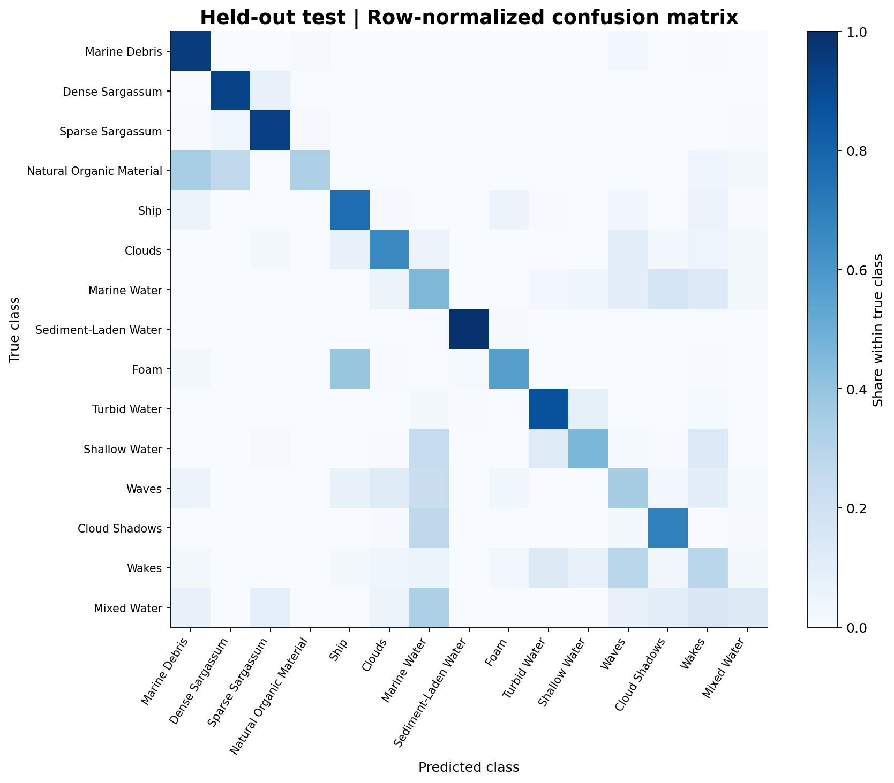
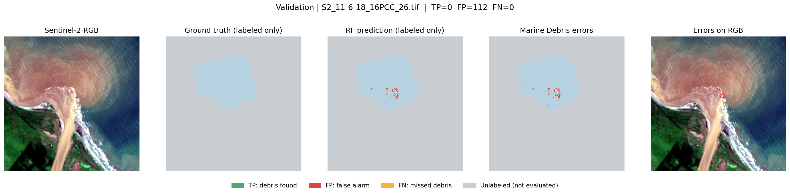
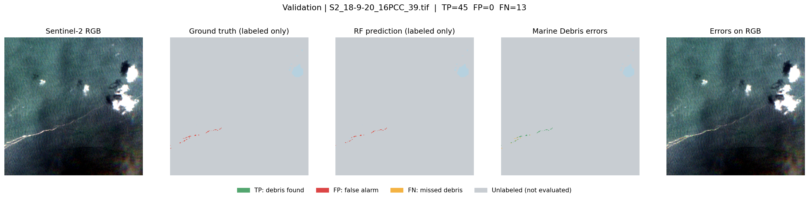

<div align="center">

# MARIDA-SpectralBench

**Spectral Benchmarks, Feature Ablation, and Scene-Level Error Analysis for Marine Debris Detection**

Reproducible pixel-level Random Forest experiments on Sentinel-2 multispectral imagery using the MARIDA benchmark, from classical baselines through feature ablation and repeated-seed, scene-aware diagnostics.

[](https://www.python.org/)
[](https://zenodo.org/records/5151941)
[](LICENSE)
[](#multi-seed-robustness-and-scene-analysis-v031)

[Overview](#overview) · [Benchmark](#benchmark-results) · [Visual Errors](#validation-patch-level-error-analysis) · [Data Verification](#hdf5geotiff-consistency-check) · [Ablation](#feature-ablation-v03) · [Robustness](#multi-seed-robustness-and-scene-analysis-v031) · [Reproduce](#reproduction) · [References](#references)


</div>

## Overview

Detecting floating marine debris in satellite imagery is challenging because debris may be confused with sediment-laden water, waves, clouds, vessels, organic matter, and other surface phenomena. This repository investigates the strengths and limitations of pixel-level spectral classification on [MARIDA](https://zenodo.org/records/5151941), with an emphasis on **reproducible baselines and observable failure cases**.

The current work includes:

- **Spectral baseline:** Random Forest trained on 11 Sentinel-2 spectral bands.
- **Feature engineering:** A second Random Forest using the same bands plus NDVI, FAI, FDI, SI, NDWI, NRD, NDMI, and BSI (19 features in total).
- **Quantitative evaluation:** Class-level F1, IoU, precision, recall, confusion matrices, and error counts.
- **Feature dependence:** Permutation-based sensitivity analysis on validation observations.
- **Visual error analysis:** Georeferenced image patches displayed alongside annotated class masks, model predictions, and localized errors.
- **Input consistency:** Checks of HDF5 spectral records against the corresponding GeoTIFF signatures and annotated class masks.
- **Feature ablation (v0.3):** Retraining six matched Random Forest variants to test the value of NDMI, NDWI, FDI, and the engineered indices collectively.
- **Robustness and scene errors (v0.3.1):** Five training seeds (30 model fits), paired comparisons, error attribution by patch/date/tile, and metadata-overlap checks.

**Scope.** The implemented models are classical pixel classifiers, not full-image semantic segmentation networks, multimodal vision-language systems, or foundation models. Engineered spectral indices are functions of the input bands and do not constitute an independent data modality.

### Results at a glance

| Experiment | Evaluation | Marine Debris F1 | Precision | Recall | Interpretation |
|:--|:--|--:|--:|--:|:--|
| v0.1 archived baseline | Full validation, 11-band RF | 0.7957 | 0.7151 | 0.8967 | Historical baseline run |
| v0.1 archived baseline | Full validation, 19-feature RF | **0.8157** | 0.7475 | 0.8977 | Selected on validation |
| v0.1 archived baseline | Held-out test, selected 19-feature RF | **0.6779** | 0.5261 | 0.9528 | Historical test evaluation; **not** used for v0.3 tuning |
| v0.2 visual diagnostics | 60 validation patches | 0.5561 | 0.4113 | 0.8583 | Selected diagnostic subset, not full validation |
| v0.3 feature ablation | Full validation, 19 features, seed 42 | **0.8187** | 0.7545 | 0.8949 | Separate re-training run |
| v0.3.1 robustness | Full validation, 19 features, mean of 5 seeds | **0.8232** | 0.7623 | 0.8949 | Arithmetic mean over seeds; F1 SD = 0.0107 |

**Read these rows as distinct experiments, not a single leaderboard.** The v0.2 diagnostic subset has a different class composition. The v0.1 and v0.3/v0.3.1 models were trained in separate runs, and v0.3.1 varies both sampling and forest randomness. The v0.3.1 average and SD describe five training seeds evaluated on the *same* official validation split, not uncertainty on independent geographic test regions.

## Benchmark Results

The recorded baseline experiment uses **100 trees**, random seed **42**, and a limit of **2,000 training pixels per class**. Training examples are sampled exclusively from the training split; both feature groups use the same sampled pixels. Sample weights reflect MARIDA annotation confidence. Models are compared on validation Marine Debris F1, and the selected model is evaluated once on the held-out test partition.

| Split | Model | Marine Debris F1 ↑ | IoU ↑ | Precision ↑ | Recall ↑ | Macro F1 ↑ |
|:--|:--|--:|--:|--:|--:|--:|
| Validation | Spectral-only RF | 0.7957 | 0.6607 | 0.7151 | 0.8967 | 0.4809 |
| Validation | Spectral + indices RF | **0.8157** | **0.6888** | **0.7475** | **0.8977** | **0.5546** |
| Held-out test | Selected spectral + indices RF | **0.6779** | **0.5127** | **0.5261** | **0.9528** | **0.5002** |

<p align="center">

</p>

Adding engineered indices improves **validation** Marine Debris F1 by **2.00 percentage points**, IoU by **2.81 percentage points**, and macro F1 by **7.37 percentage points**. Test Marine Debris F1 is **13.79 percentage points** below validation F1. A change in class prevalence and scene composition may contribute; the difference alone does not establish overfitting.

### Held-out test: where the classifier struggles

The selected classifier produced **363 true positives (TP), 327 false positives (FP), and 18 false negatives (FN)** for Marine Debris on the full test split. Its high debris recall (0.9528) is accompanied by substantially lower precision (0.5261).

<p align="center">

</p>

Wave, cloud, and ship pixels are the main sources of test-set false-positive debris predictions.

<details>
<summary><b>View test F1 by class and normalized confusion matrix</b></summary>

<p align="center">


</p>

</details>

### Training data and sampling

The original training split contains **429,412 labeled pixels**; **23,320** were retained for model fitting. Classwise sampling reduces computational cost but changes the class proportions observed during training.

<p align="center">

</p>

### Spectral feature dependence

<p align="center">

</p>

Permuting **NDMI**, **NDWI**, and **FDI** produced the largest positive reductions in Marine Debris F1 on the sampled validation data. These scores indicate **model dependence**, not causal importance or mechanistic interpretability. Related spectral bands and indices are correlated; rankings can change with sample selection and perturbations. A negative importance value means that shuffling the feature improved the score on that particular sample.

## Validation Patch-Level Error Analysis

To inspect *where* classification mistakes occur, the selected `spectral_plus_indices` Random Forest was applied to **60 validation GeoTIFF patches**, and predictions were compared against their corresponding class masks. The visualization includes satellite RGB composites, annotated ground truth, model predictions, error maps, and overlays.

**Evaluation rule:** Metrics and error maps are computed from **annotated pixels only**. Unlabeled pixels are not assumed to be clean water, background, or negatives. The RGB composites are intended for human inspection; the classifier uses the 11-band spectral measurements, not the rendered RGB image.

### Diagnostic subset results

| Metric | Value |
|:--|--:|
| Inspected validation patches | 60 |
| Evaluated labeled pixels | 102,285 |
| Marine Debris true positives | 109 |
| Marine Debris false positives | 156 |
| Marine Debris false negatives | 18 |
| Marine Debris precision | 0.4113 |
| Marine Debris recall | 0.8583 |
| Marine Debris F1 | 0.5561 |

These figures pool labeled-pixel counts across the inspected patches; they are **not** the mean of per-patch F1 values. Patches with no positive labels and no positive predictions do not have a meaningful positive-class F1. This subset has a different distribution from the complete validation and test partitions, so its metrics should not be interpreted as an overall performance regression.

<p align="center">


</p>

Of the **156 false positives**, **112 (71.8%)** occur in one patch, `S2_11-6-18_16PCC_26.tif`, with the true class **Sediment-Laden Water**. These 112 annotated pixels have **high-confidence labels**. This concentration motivates a focused investigation of sediment-rich scenes; the plots alone do not identify the physical cause of confusion.

### Case study A: sediment-laden water mistaken for debris

**Patch:** `S2_11-6-18_16PCC_26.tif` — **0 TP · 112 FP · 0 FN**

<p align="center">

</p>

False-positive debris predictions cluster in a localized sediment-laden region. Whether these errors stem from overlapping spectral signatures, scene-specific conditions, or other factors remains to be tested. This is a **failure observation**, not evidence of a confirmed causal mechanism.

### Case study B: missed debris within a narrow surface feature

**Patch:** `S2_18-9-20_16PCC_39.tif` — **45 TP · 0 FP · 13 FN**

<p align="center">

</p>

Of the 13 missed debris pixels, **10 were predicted as Clouds** and **3 as Waves**. This image motivates testing whether spatial context helps a classifier distinguish debris from nearby surface phenomena; improved performance from a spatial model has **not yet been demonstrated**.

<details>
<summary><b>Additional validation cases</b></summary>

The following patches illustrate other error types without establishing their prevalence across the complete dataset.

| Patch | Observed error pattern |
|:--|:--|
| `S2_18-1-18_48PZC_25.tif` | 6 FP associated with cloud/cloud-shadow labels |
| `S2_18-9-20_16PCC_64.tif` | 4 FP associated with ship labels |
| `S2_18-9-20_16PCC_29.tif` | 3 FP and 2 FN across a mixed scene |

<p align="center">


</p>

</details>

**Outputs:** `results/visual_analysis/` contains the diagnostic subset summary, a per-patch error table, false-positive counts grouped by true class, and the pixel locations of analyzed errors. Figures are saved under `assets/figures/visual_errors/`.

## HDF5–GeoTIFF Consistency Check

The original Random Forest was trained on the annotated-pixel `dataset.h5` export, whereas patch-level visual diagnostics read the multispectral GeoTIFFs. We therefore checked whether spectral signatures and annotated classes agreed between the two sources **before interpreting localized failure cases**.

The consistency script matches HDF5 records for selected patches to **labeled GeoTIFF pixels using their 11-dimensional spectral signatures**, then checks the label at the matched location. The check allows numerical tolerance and tests common scaling factors.

### Recorded verification results

| Validation patch | HDF5 rows checked | Near spectral match | Spectral + label agreement | Best scale factor | Status |
|:--|--:|--:|--:|--:|:--|
| `S2_11-6-18_16PCC_26.tif` | 200 | 100% | 100% | 1.0 | PASS |
| `S2_18-9-20_16PCC_39.tif` | 200 | 100% | 100% | 1.0 | PASS |
| `S2_18-9-20_16PCC_29.tif` | 11 | 100% | 100% | 1.0 | PASS |
| **Total / sampled check** | **411** | **100%** | **100%** | — | **3/3 PASS** |

The three patches contain **8,677**, **443**, and **11** labeled GeoTIFF pixels respectively; the verification examines up to 200 HDF5 rows per patch. The selected records matched at the configured tolerance **without rescaling**.

**Verification boundaries:**

- Matching is based on nearby spectral signatures and class agreement, **not** an independently established one-to-one mapping from HDF5 coordinates to raster row/column indices.
- `XCoords`/`YCoords` were not verified as raster pixel indices (`not_pixel_coordinates` in the script output). **Spatial coordinate agreement remains unverified.**
- A nearest-spectral-signature match can be ambiguous when several pixels share identical or similar spectra.
- The result covers **411 sampled records in three selected patches**, not the full archive, and does not independently validate the GeoTIFF georeferencing, every pixel prediction, or every annotation.

This check substantially reduces concern about a simple **band-value or scaling mismatch** in these inspected examples. It does not prove a particular explanation for the model errors.

The script exports `results/data_consistency/data_consistency_summary.csv`, `results/data_consistency/band_differences.csv`, and `assets/figures/data_consistency/band_differences.png`.

<details>
<summary><b>View per-band difference visualization</b></summary>

<p align="center">

</p>

</details>

## Feature Ablation (v0.3)

The initial permutation analysis suggested that **NDMI**, **NDWI**, and **FDI** were influential for the fitted model. However, shuffling an input in a trained model does not tell us what happens if that input is **removed and the model is retrained**. We therefore performed a controlled feature ablation on the annotated-pixel MARIDA HDF5 data.

### Experimental protocol

- Six feature sets: `full_19` (all 11 spectral bands + 8 indices), `minus_ndmi`, `minus_ndwi`, `minus_fdi`, `minus_three` (all three removed), and `bands_only` (11 raw bands).
- Fixed seed **42**, **100 trees**, `min_samples_leaf=2`, up to **2,000 training pixels per class**, and confidence-based sample weights (High = 1, Moderate = 0.5, Low = 1/3).
- All six models are trained on the **same 23,320 sampled training pixels** and evaluated on **all 213,102 labeled validation pixels**; median imputation uses training data only.
- The **test partition is not used** for selecting ablation features or comparing these variants.
- Feature selection is performed before fitting each model. The engineered features still originate from the same 11 spectral bands; no additional remote-sensing modality is introduced.

### Single-seed validation results

| Feature set | # features | Debris F1 ↑ | Precision ↑ | Recall ↑ | IoU ↑ | Debris FP ↓ | Sediment-water FP ↓ |
|:--|--:|--:|--:|--:|--:|--:|--:|
| **All features (`full_19`)** | 19 | **0.8187** | **0.7545** | 0.8949 | **0.6931** | **313** | 112 |
| Without NDMI | 18 | 0.8028 | 0.7286 | 0.8940 | 0.6706 | 358 | 115 |
| Without NDWI | 18 | 0.8116 | 0.7504 | 0.8837 | 0.6830 | 316 | 69 |
| Without FDI | 18 | 0.8045 | 0.7301 | **0.8958** | 0.6730 | 356 | 142 |
| Without NDMI, NDWI, FDI | 16 | 0.7945 | 0.7162 | 0.8921 | 0.6591 | 380 | **65** |
| Original spectral bands only | 11 | 0.7890 | 0.7072 | 0.8921 | 0.6515 | 397 | 99 |

<p align="center">

</p>

**Finding:** Within this seed-42 experiment, removing any of the three selected indices reduces *overall* Marine Debris F1. Removing NDWI reduces the sediment-laden-water false positives from **112 to 69** (43 fewer; **38.4%**), but increases the total false positives from **313 to 316** and false negatives from **113 to 125**. It also increases ship-to-debris errors (**66 to 94**) and wake-to-debris errors (**21 to 46**). Reducing one type of error is not equivalent to improving the complete validation benchmark.

<p align="center">

</p>

The known sediment example `S2_11-6-18_16PCC_26.tif` contains no annotated Marine Debris and is the source of **all 112 sediment-related false positives for the full model in this validation run**. This example is useful for diagnosis, but it is **not** an independent test or a sufficient basis for dropping NDWI. The experiment supports feature-set *associations within this benchmark*, not a causal explanation of the spectral indices.

**Artifacts:** `results/ablation/validation_comparison.csv`, `false_positives_by_true_class.csv`, `known_validation_patch_comparison.csv`, `run_config.json`, and plots in `assets/figures/ablation/`. See [`docs/feature_ablation.md`](docs/feature_ablation.md).

## Multi-Seed Robustness and Scene Analysis (v0.3.1)

The one-seed ablation cannot show whether feature rankings remain consistent when the training sample and forest randomness change. We therefore repeated all six ablation variants with seeds **42, 7, 21, 123, and 2026** (**5 seeds × 6 feature sets = 30 fitted models**). Within each seed, all models use the same selected training observations; across seeds, sampling and model randomness change. Every model is evaluated against the **same 213,102 labeled validation pixels**, with no new test-set tuning.

### Stability across five seeds

| Feature set | Mean Debris F1 ↑ | SD of F1 | Mean FP ↓ | Mean FN ↓ | Mean sediment FP ↓ |
|:--|--:|--:|--:|--:|--:|
| **All 19 features** | **0.8232** | 0.0107 | **300.4** | 113.0 | 100.8 |
| Without FDI | 0.8131 | 0.0118 | 331.0 | 112.2 | 125.0 |
| Without NDMI | 0.8123 | **0.0079** | 337.4 | 109.2 | 113.4 |
| Without NDWI | 0.8061 | 0.0055 | 330.8 | 126.0 | 90.2 |
| Spectral bands only | 0.8047 | 0.0110 | 361.2 | **108.4** | **64.6** |
| Without all three | 0.7745 | 0.0126 | 448.4 | 112.6 | 114.8 |

SD is the sample standard deviation of the five *seed-level F1 values*, not a 95% confidence interval. Mean error counts can be fractional because they are averages of integer counts over five fits.

<p align="center">


</p>

The full 19-feature model leads the **mean F1** ranking and wins in **3 of 5 seeds**. The best model per seed is:

| Seed | Highest-F1 feature set | Winning F1 |
|--:|:--|--:|
| 42 | All 19 features | 0.8187 |
| 7 | Without NDMI | 0.8168 |
| 21 | Without FDI | 0.8250 |
| 123 | All 19 features | 0.8296 |
| 2026 | All 19 features | 0.8389 |

In **all five paired seed comparisons**, removing NDWI lowers F1 relative to the corresponding full model. On average, dropping NDWI changes F1 by **−0.0172** (−1.72 percentage points), FP by **+30.4**, and FN by **+13.0**. This supports retaining NDWI for the current validation objective, despite its mixed effects on sediment-laden-water errors. These are *within-validation* findings; five seeds do not prove statistical superiority on unseen regions.

### Where errors concentrate: acquisition groups and patches

Each patch is identified by `Date + Tile + Image`. We aggregate patches by **`Date + Tile`** as an *acquisition-group proxy* and by `Tile` as a broad *geographic-ID proxy*. This describes how observed errors are distributed; it is **not** grouped cross-validation or a scene-independent holdout.

Across the validation split there are **328 distinct patches**, **12 Date+Tile acquisition groups**, and **7 distinct Tile identifiers**.

| Date + Tile | Labeled pixels | Mean debris FP | FP per 1,000 labeled px | Mean debris FN | Main observed issue |
|:--|--:|--:|--:|--:|:--|
| **11-6-18 / 16PCC** | 29,232 | **126.0** | 4.31 | 1.0 | Sediment-laden water |
| **18-9-20 / 16PCC** | 75,662 | **87.6** | 1.16 | **76.4** | Ships/wakes and missed debris |
| 18-1-18 / 48PZC | 4,902 | 20.4 | 4.16 | 1.6 | Ships/clouds |
| 12-1-17 / 16PEC | 7,681 | 16.6 | 2.16 | 0.0 | Ships |
| 29-12-20 / 18QYF | 1,965 | 13.8 | 7.02 | 1.4 | Clouds |

<p align="center">

</p>

The first two acquisition groups together account for about **71.1%** of the full model's mean false positives (213.6 of 300.4). The `18-9-20 / 16PCC` group accounts for **76.4 of 113.0 mean false negatives** (about **67.6%**). Within it, patch `S2_18-9-20_16PCC_17.tif` has **38 labeled debris pixels** and **32.2 missed debris pixels on average**, making it a priority for subsequent visual inspection.

Error counts depend on annotation coverage. For example, `24-3-20 / 18QYF` has only **94 labeled pixels**, so even **3.8 mean FP** corresponds to **40.43 FP per 1,000 labeled pixels**. Such small-denominator rates require caution. None of these labeled-pixel rates is a whole-scene false-alarm rate over every pixel.

### Does dropping NDWI consistently fix sediment false positives?

Not consistently. The sediment-related errors in these validation evaluations are concentrated in **one patch**, `S2_11-6-18_16PCC_26.tif`, and the effect of removing NDWI changes across seeds:

| Seed | Sediment FP: full 19 | Sediment FP: without NDWI | Change |
|--:|--:|--:|:--|
| 42 | 112 | 69 | 43 fewer |
| 7 | 113 | 72 | 41 fewer |
| 21 | 129 | 78 | 51 fewer |
| 123 | 87 | 107 | 20 more |
| 2026 | 63 | 125 | 62 more |
| **Mean** | **100.8** | **90.2** | **10.6 fewer** |

Removing NDWI reduces sediment FP for **3 seeds** and increases it for **2**. Across **all** validation scenes, the full model still has lower mean total FP (**300.4 vs 330.8**), lower mean FN (**113.0 vs 126.0**), and higher mean F1 (**0.8232 vs 0.8061**). The `18-9-20 / 16PCC` group alone incurs **24.8 additional FP** and **9.0 additional FN** on average without NDWI.

<p align="center">

</p>

A **descriptive sensitivity check** resampled the 12 complete Date+Tile groups **1,000 times**, using paired predictions from seed 42. The percentile range for `F1(without NDWI) − F1(full)` was **[−0.0372, +0.0380]**, or **−3.72 to +3.80 percentage points**. This interval describes sensitivity to the mixture of acquisition groups in the *existing* validation set. It is **not** a formal 95% confidence interval for future regions or an independent test estimate.

### Train–validation metadata overlap

To assess whether the existing split supports a strong claim of spatial independence, we checked shared group identifiers between the official train and validation tables:

| Identifier granularity | Train groups | Validation groups | Identifiers shared |
|:--|--:|--:|--:|
| Exact Patch (`Date + Tile + Image`) | 694 | 328 | **0** |
| Acquisition proxy (`Date + Tile`) | 36 | 12 | **0** |
| Geographic proxy (`Tile`) | 13 | 7 | **5** |

The shared Tile IDs are `16PCC`, `16PDC`, `16PEC`, `18QYF`, and `48PZC`. Thus **5 of 7 distinct validation Tile IDs (71.4%)** also occur in training. This percentage is **of Tile identifiers**, not of validation pixels or geographic surface area.

**Interpretation:** No *identically labeled* Patch ID or Date+Tile ID is shared in this check; however, five broad geographic Tile identifiers appear in both splits. Shared Tile names **do not establish duplicate-pixel leakage**, and distinct IDs **do not prove spatial independence**. The official split is therefore not a demonstrated geographic holdout. Claims of generalization to new geographic areas require a genuinely group-disjoint evaluation with adequate debris-class coverage.

**Artifacts:** `results/robustness/per_seed_validation.csv`, `summary_by_model.csv`, `paired_summary.csv`, `scene_error_summary.csv`, `patch_error_summary.csv`, `scene_ndwi_tradeoff.csv`, `train_val_group_overlap.csv`, `scene_bootstrap_descriptive.csv`, `run_config.json`, and plots in `assets/figures/robustness/`. The automatically generated narrative is stored in `results/robustness/robustness_findings.md`. See [`docs/robustness_and_scene_analysis.md`](docs/robustness_and_scene_analysis.md).

## Dataset

[MARIDA](https://zenodo.org/records/5151941) contains **1,381** Sentinel-2 multispectral patches (**256 × 256** pixels each), sparse/weak pixel-level annotations covering **15 marine classes**, annotation-confidence masks, GIS metadata, and official train/validation/test split manifests.

Download the official dataset and prepare the annotated-pixel HDF5 file (`dataset.h5`) and GeoTIFF images locally. The expected layout is:

```text
baseline/data/
├── dataset.h5
├── labels_mapping.txt
├── patches/
│   └── S2_<date>_<tile>/
│       ├── S2_<date>_<tile>_<index>.tif
│       ├── S2_<date>_<tile>_<index>_cl.tif
│       └── S2_<date>_<tile>_<index>_conf.tif
├── shapefiles/
└── splits/
    └── val_X.txt
```

Training and full-split evaluation read HDF5. Patch visualization and error localization read the **original GeoTIFFs, class masks, and official validation manifest**. The verification script reads both sources. No raw MARIDA data or fitted model weights are distributed with this repository.

For annotation conventions and preprocessing assumptions, see [Dataset and protocol](docs/dataset_and_protocol.md) and the [MARIDA project](https://marine-debris.github.io/).

## Reproduction

**Recommended environment:** Python 3.11 in PyCharm. Configure the project's Python interpreter and install dependencies from [`requirements.txt`](requirements.txt). In particular, Pandas HDF5 access requires **PyTables (`tables`)**, and patch visualization requires **tifffile**. The scripts use **PyCharm Run**, with no command-line arguments and no custom object-oriented architecture.

### Workflow

| Step | Script | Purpose | Main outputs |
|:--|:--|:--|:--|
| 1 | [`01_inspect_dataset.py`](baseline/01_inspect_dataset.py) | Inspect train/validation/test tables and labeled-pixel balance | Dataset summaries and class plots |
| 2 | [`02_train_random_forest.py`](baseline/02_train_random_forest.py) | Sample training pixels and fit two RF baselines | Local `models/*.joblib`, training tables |
| 3 | [`03_evaluate_models.py`](baseline/03_evaluate_models.py) | Select on validation and evaluate the winner on test | F1/IoU, per-class reports, confusion matrices |
| 4 | [`04_analyze_features.py`](baseline/04_analyze_features.py) | Measure feature dependence on a validation sample | Feature ranking CSV and figure |
| 5 | [`05_analyze_test_errors.py`](baseline/05_analyze_test_errors.py) | Summarize errors from the recorded test predictions | FP/FN charts and tables |
| 6 | [`06_visualize_satellite_patch.py`](baseline/06_visualize_satellite_patch.py) | Inspect original satellite imagery and masks | Patch visualization |
| 7 | [`07_visual_error_analysis.py`](baseline/07_visual_error_analysis.py) | Localize prediction errors in validation patches | Patch-level CSVs and five-view images |
| 8 | [`08_verify_hdf_geotiff.py`](baseline/08_verify_hdf_geotiff.py) | Check spectral/label consistency between HDF5 and GeoTIFF | Match-rate tables and difference plot |
| 9 | [`09_feature_ablation.py`](baseline/09_feature_ablation.py) | Retrain six feature sets under the same seed-42 training sample and evaluate full validation | `results/ablation/validation_comparison.csv`, model files |
| 10 | [`10_compare_ablation_patches.py`](baseline/10_compare_ablation_patches.py) | Compare the six models on the known sediment-error patch | `results/ablation/known_validation_patch_comparison.csv` |
| 11 | [`11_multi_seed_robustness.py`](baseline/11_multi_seed_robustness.py) | Repeat six models across five seeds; record patch/scene/tile confusion counts | `results/robustness/per_seed_validation.csv`, group tables |
| 12 | [`12_analyze_scene_errors.py`](baseline/12_analyze_scene_errors.py) | Analyze seed stability, group-level trade-offs, and train/validation metadata overlap | Summary CSVs, descriptive bootstrap, report and plots |

Scripts **1–4** establish the archived classical benchmark; **7–8** provide v0.2 visual diagnostics and data verification; **9–10** run the six-model v0.3 ablation; and **11–12** repeat and analyze those comparisons across five seeds (v0.3.1). Script 10 requires models saved by script 09; script 12 requires outputs from script 11. For the recorded v0.2 visual analysis, the images came from the existing trained `spectral_plus_indices.joblib`; scripts 07–08 do **not** retrain the model.

Set baseline paths and model parameters in [`baseline/settings.py`](baseline/settings.py). For the archived baseline run use `RANDOM_SEED = 42`, `TRAIN_SAMPLES_PER_CLASS = 2000`, and `NUMBER_OF_TREES = 100`. Script 07 additionally needs local GeoTIFFs and the validation split list; script 08 needs both HDF5 and selected GeoTIFFs. The ablation and robustness scripts expose their experiments/seeds in their source files and record their configurations in `results/ablation/run_config.json` and `results/robustness/run_config.json`.

**Outputs and repository hygiene:**

- `results/benchmark/` holds archived results from the completed baseline experiment.
- `results/visual_analysis/` holds patch-level error summaries and diagnostic CSVs.
- `results/data_consistency/` holds spectral and label consistency tables.
- `results/ablation/` holds v0.3 single-seed comparisons and the difficult-patch diagnostic.
- `results/robustness/` holds v0.3.1 multi-seed scores, patch/acquisition/Tile summaries, overlap checks, and the descriptive resampling analysis.
- `assets/figures/ablation/` and `assets/figures/robustness/` hold the new figures used above.
- `assets/figures/` contains selected figures referenced by this README.
- `results/runs/latest/` contains intermediate outputs from new local runs; `models/` contains locally saved fitted models. Both are excluded from Git.
- `baseline/data/` is intentionally excluded from Git; refer to the [official MARIDA download](https://zenodo.org/records/5151941) to obtain the original data.

Dependencies may vary with environment and the original environment was not recorded as a complete lockfile. Reproducing precisely the published numbers additionally requires consistent data versions, training sampling, labels, and scoring choices.

## Repository Layout

```text
MARIDA-SpectralBench/
├── README.md
├── LICENSE
├── requirements.txt
├── .gitignore
├── assets/
│   └── figures/
│       ├── benchmark_scores.png
│       ├── feature_importance.png
│       ├── visual_errors/
│       │   ├── S2_11-6-18_16PCC_26_visual_errors.png
│       │   ├── S2_18-9-20_16PCC_39_visual_errors.png
│       │   └── ...
│       ├── data_consistency/
│       │   └── band_differences.png
│       ├── ablation/                      # New six-model comparison charts
│       │   ├── validation_f1_by_feature_set.png
│       │   └── sediment_false_positives.png
│       └── robustness/                    # Five-seed and scene charts
│           ├── validation_f1_mean_sd.png
│           ├── validation_f1_across_seeds.png
│           ├── top_error_scenes.png
│           └── scene_ndwi_sediment_tradeoff.png
├── baseline/
│   ├── settings.py
│   ├── spectral_features.py
│   ├── 01_inspect_dataset.py
│   ├── 02_train_random_forest.py
│   ├── 03_evaluate_models.py
│   ├── 04_analyze_features.py
│   ├── 05_analyze_test_errors.py
│   ├── 06_visualize_satellite_patch.py
│   ├── 07_visual_error_analysis.py
│   ├── 08_verify_hdf_geotiff.py
│   ├── 09_feature_ablation.py
│   ├── 10_compare_ablation_patches.py
│   ├── 11_multi_seed_robustness.py
│   ├── 12_analyze_scene_errors.py
│   └── data/                    # Local only; excluded from Git
├── docs/
│   ├── dataset_and_protocol.md
│   ├── experiment_notes.md
│   ├── visual_error_analysis.md
│   ├── data_consistency.md
│   ├── feature_ablation.md
│   └── robustness_and_scene_analysis.md
├── models/                      # Local only; excluded from Git
├── results/
│   ├── benchmark/               # Archived baseline CSV results
│   ├── visual_analysis/         # Diagnostic subset CSV results
│   ├── data_consistency/        # Spectral verification CSV results
│   ├── ablation/                # Six-model validation CSVs
│   ├── robustness/              # Seed-level and scene-level diagnostics
│   └── runs/                    # Local interim runs; excluded from Git
└── tests/
    └── check_features.py
```

## Limitations and Next Steps

The completed experiments establish a **reproducible classical-machine-learning benchmark, controlled feature ablations, and preliminary robustness/error analyses**—not a new state-of-the-art dense segmentation system.

- **Sparse and weak annotations:** Only labeled pixels are scored. Gray/unlabeled image areas are not negatives, and no whole-scene segmentation metric is claimed.
- **Per-pixel inputs, no learned spatial context:** Random Forest uses spectral inputs and engineered indices, not neighboring-pixel texture or object shape.
- **Training prior shift:** Per-class subsampling and confidence weighting alter the effective training distribution and may affect calibration.
- **Differences across experiment snapshots:** The archived v0.1 seed-42 validation F1 (**0.8157**) and the separately retrained v0.3 seed-42 F1 (**0.8187**) are not numerically identical. Their original predictions/sampling/implementation details were not shown to be identical, so retain them as distinct experiments rather than silently merging results.
- **Only five training seeds:** Repeated seeds measure a limited component of training variability on a *fixed* validation set; they do not quantify uncertainty over unseen geography, seasons, sensors, or annotation processes.
- **Scene-concentrated errors and small denominators:** Large fractions of false alarms/misses are concentrated in a few acquisition groups; group-level rates depend on annotation coverage.
- **No verified geographic holdout:** Exact Patch and Date+Tile IDs are disjoint in the metadata check, but **five Tile IDs overlap** between train and validation. This neither proves leakage nor justifies a claim of spatially independent generalization.
- **Descriptive bootstrap only:** Resampling existing Date+Tile groups is a sensitivity analysis, not a definitive out-of-domain confidence interval.
- **Partial HDF5–GeoTIFF verification:** The spectral/label check passed on 411 sampled records, but the one-to-one pixel-coordinate mapping and full archive have not been independently verified.
- **No causal mechanism identified:** Permutation importance and ablation results describe predictive dependence under the chosen training conditions; they do not establish physical causality.
- **Held-out test discipline:** The historical v0.1 test set has already been inspected. Subsequent selection and hypothesis development are based on train/validation only. A truly new independent evaluation is needed for strong final claims after further model development.

### Planned research (not yet implemented)

1. **Group-disjoint validation / geographic holdout:** Design a carefully balanced evaluation with nonoverlapping geographic Tile or scene groups, sufficient annotated Marine Debris, and documented area/date coverage; keep the official test split untouched during new model selection.
2. **Spatial segmentation baseline:** Compare a multispectral U-Net or another spatial model against the spectral RF under matched splits and evaluation definitions, while respecting missing annotations.
3. **Robustness beyond training seeds:** Measure performance across independent areas/acquisition conditions and assess whether the observed sediment/ship/wake confusions persist.
4. **Remote-sensing pretrained encoders and evidence retrieval:** Evaluate suitable foundation models or parameter-efficient adaptation and support explanations with traceable image/spectral evidence.

Results from these steps will be reported separately from the completed **v0.1**, **v0.2**, **v0.3**, and **v0.3.1** experiments.

## References

**MARIDA dataset and benchmark**

Kikaki, K., Kakogeorgiou, I., Mikeli, P., Raitsos, D. E., & Karantzalos, K. (2022). *MARIDA: A benchmark for Marine Debris detection from Sentinel-2 remote sensing data*. *PLOS ONE*, 17(1), e0262247. https://doi.org/10.1371/journal.pone.0262247

**Related remote-sensing foundation model research**

Liu, F., et al. (2024). *RemoteCLIP: A Vision Language Foundation Model for Remote Sensing*. *IEEE Transactions on Geoscience and Remote Sensing*. https://doi.org/10.1109/TGRS.2024.3390838

This is an independent benchmark project and is **not affiliated with the MARIDA or RemoteCLIP authors**.

## Maintainer

[Mehdi Hashemi](https://github.com/mehdi-hashemi-01) · [MIT License](LICENSE)
