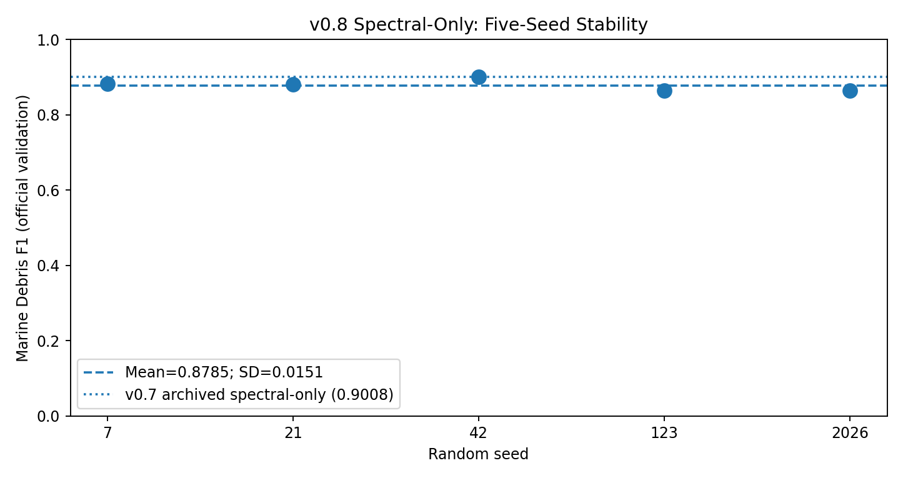
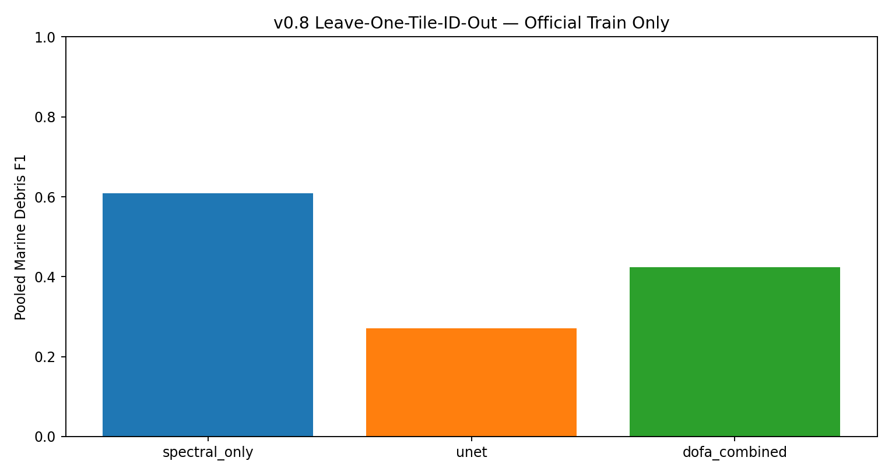

# MARIDA-SpectralBench v0.8 — Empirical Research Findings

**Status:** Multi-seed reproducibility and 13-fold nested Tile-ID evaluation completed; the matched random-initialization DOFA control is **not present** in the supplied artifacts.  
**Dataset:** MARIDA, 11 Sentinel-2 bands, 15 annotated classes; class 0 is unlabeled and excluded from metrics.  
**Methods:** Five-seed Spectral Only evaluation and leave-one-Tile-ID-out evaluation of Spectral Only, 11-band U-Net, and frozen pretrained DOFA with raw-spectral skip.  
**Evidence:** User-provided `v08.zip` and `v08(1).zip`; cross-checked CSV, JSON, per-fold manifests and confusion matrices.  
**Scope:** Research/portfolio technical report, not a peer-reviewed publication or an independent external test claim.

## Abstract

A compact spectral-only segmentation decoder achieved a high official-validation Marine Debris F1 of 0.9008 in v0.7. To examine whether that result persists under training randomness and grouped evaluation, v0.8 retrained the decoder with five random seeds and evaluated three model families using nested leave-one-Tile-ID-out folds within the official MARIDA training partition. The five-seed official-validation mean F1 was **0.8785** (sample SD **0.0151**). Across **13** outer Tile-ID folds, pooled F1 was **0.6089** for Spectral Only, **0.4232** for frozen DOFA with spectral skip, and **0.2716** for U-Net, calculated over **429,412 annotated pixels including 1,943 labeled debris pixels**. The ranking supports the compact spectral decoder as the strongest of these three *under the specific nested grouped benchmark*, but there is substantial Tile-to-Tile variation and the Tile identifiers have not undergone independent geospatial footprint verification. A causal claim about DOFA pretraining remains premature because the separately specified pretrained-versus-random control was not among the submitted results.

## 1. Research questions

**Q1 — Reproducibility:** How sensitive is the high Spectral Only validation F1 to fitting stochasticity?  
**Q2 — Geographic-proxy generalization:** How does the model compare with U-Net and pretrained DOFA when a complete Tile ID is withheld during fitting and checkpoint selection?  
**Q3 — Pretraining:** Are DOFA representations better than randomly initialized representations under matched frozen-encoder conditions? **Pending experimental output.**

## 2. Data and experimental protocol

MARIDA includes **694 official Train**, **328 official Validation**, and **359 official Test** patches. The multi-seed experiment used all 694 Train patches for fitting and the official Validation (328 patches, **213,102 annotated pixels**) for checkpoint selection and reporting; it should be characterized as an *internally selected validation score*, not as an untouched estimate. The geographic experiment used **only the official Train**. For each of 13 outer folds, one entire Tile ID was held out; remaining Train patches were split into fitting and checkpoint-validation subsets by nonoverlapping **Date+Tile acquisition groups**. Checkpoint selection and fitting-only normalization excluded the outer Tile. The three models shared the same outer and inner patch partitions, one training seed (42), and a common nominal batch size of 4 and training-epoch cap of 30, although their architectures and inductive biases differed.

Original MARIDA Test was inspected in earlier historical experiments, and **neither v0.8 experiment opened it** according to the submitted protocol and recorded output. No newly independent external validation is claimed. This analysis verified manifest set disjointness and count consistency, not geographic footprint overlap or the source imagery itself.

## 3. Five-seed Spectral Only reproducibility

| Seed | Best epoch | F1 | Precision | Recall | TP | FP | FN |
|---:|---:|---:|---:|---:|---:|---:|---:|
| 42 | 23 | 0.9008 | 0.9106 | 0.8912 | 958 | 94 | 117 |
| 7 | 17 | 0.8822 | 0.8506 | 0.9163 | 985 | 173 | 90 |
| 21 | 23 | 0.8808 | 0.8587 | 0.9042 | 972 | 160 | 103 |
| 123 | 8 | 0.8642 | 0.8389 | 0.8912 | 958 | 184 | 117 |
| 2026 | 12 | 0.8645 | 0.8402 | 0.8902 | 957 | 182 | 118 |

**Mean F1 = 0.8785; sample SD = 0.0151; range = [0.8642, 0.9008].** All five fits exceed F1 0.86 on the same official Validation population; seed 42 is the largest observed value and should not be presented as the average. Checkpoints were selected by that validation F1, so the estimates are potentially optimistic. Five-seed SD is a measure of fitted-model variability conditional on these data, **not** an uncertainty interval for a new coastline.

## 4. Nested Tile-ID geographic evaluation

| Model | Pooled F1 | Precision | Recall | IoU | TP | FP | FN | Macro Tile F1¹ |
|:--|--:|--:|--:|--:|--:|--:|--:|--:|
| spectral_only | 0.6089 | 0.5565 | 0.6722 | 0.4377 | 1306 | 1041 | 637 | 0.5529 |
| dofa_combined | 0.4232 | 0.2951 | 0.7478 | 0.2684 | 1453 | 3470 | 490 | 0.4213 |
| unet | 0.2716 | 0.1949 | 0.4478 | 0.1571 | 870 | 3594 | 1073 | 0.2105 |

¹ *Tile-macro F1 is the unweighted mean across the ten Tile IDs with annotated debris. The three Tiles without annotated debris are excluded from positive-class Tile-macro F1, but their false positives are included in pooled F1.*

For each of the three models, exactly **694 original Train patches** contributed one held-out prediction and **429,412 labeled pixels** were pooled, including **1,943 debris pixels**. Spectral Only delivers **18.56 percentage points** higher pooled F1 than DOFA with raw skip and **33.73 points** higher than U-Net. DOFA with skip has higher debris recall (0.7478 versus 0.6722), but incurs **3,470** false positives rather than **1,041**.

### 4.1 Per-Tile results and class support

| Held-out Tile | Debris pixels | Spectral Only F1 | DOFA + skip F1 | U-Net F1 |
|:--|--:|--:|--:|--:|
| `16PCC` | 841 | 0.4967 | 0.4164 | 0.3459 |
| `16PDC` | 67 | 0.6165 | 0.3583 | 0.0794 |
| `16PEC` | 118 | 0.5351 | 0.2979 | 0.1345 |
| `16QED` | 0 | 0.0000 | 0.0000 | 0.0000 |
| `18QWF` | 0 | 0.0000 | 0.0000 | 0.0000 |
| `18QYF` | 606 | 0.8773 | 0.5110 | 0.5336 |
| `19QDA` | 0 | 0.0000 | 0.0000 | 0.0000 |
| `30VWH` | 27 | 0.0667 | 0.0000 | 0.0714 |
| `36JUN` | 46 | 0.2574 | 0.2150 | 0.0373 |
| `48MXU` | 208 | 0.8320 | 0.9718 | 0.1724 |
| `48MYU` | 24 | 0.7660 | 0.4138 | 0.6875 |
| `48PZC` | 2 | 1.0000 | 1.0000 | 0.0000 |
| `52SDD` | 4 | 0.0816 | 0.0288 | 0.0429 |

**Important class-support caveat:** `16QED`, `18QWF`, and `19QDA` have **no annotated debris**. Their recorded per-Tile positive-class F1 values are zero because of false-positive predictions; such values must not be interpreted as meaningful debris-detection F1 on positive cases. `48PZC` contains only **two** labeled debris pixels, so its F1 = 1.0 for two methods is highly unstable. The largest Tile, `16PCC`, contains **841** of 1,943 debris pixels and contributes **279,618** of 429,412 annotated pixels, making the pooled result sensitive to that acquisition mix.

Two notable examples: Spectral Only F1 is **0.8773** on `18QYF` (606 debris pixels) but **0.0667** on `30VWH` (27 debris pixels). On `48MXU` (208 debris pixels), DOFA+skip scores **0.9718**, above Spectral Only's **0.8320**. These cases underline geographic heterogeneity and rule out statements of uniform superiority.

### 4.2 False-positive sources from pooled confusion matrices

| True class incorrectly predicted as debris | Spectral Only FP | DOFA + skip FP | U-Net FP |
|:--|--:|--:|--:|
| Ship | 206 | 291 | 297 |
| Natural Organic Material | 189 | 426 | 241 |
| Clouds | 188 | 181 | 322 |
| Waves | 159 | 84 | 183 |
| Wakes | 135 | 355 | 122 |
| Sediment-Laden Water | 0 | 1 | 754 |
| Marine Water | 10 | 1121 | 79 |
| Turbid Water | 9 | 160 | 570 |

The largest Spectral Only held-out debris false-positive sources are **Ship (206)**, **Natural Organic Material (189)**, **Clouds (188)**, **Waves (159)**, and **Wakes (135)**. Its largest debris false-negative destination is **Ship (456)**. These numbers describe **annotated pixels**, not full-coverage scene-level false-alarm rates. For DOFA with skip, Marine Water contributes **1,121** of 3,470 false positives; for U-Net, Sediment-Laden Water contributes **754** of 3,594.

## 5. Audit of supplied outputs

- Both files were readable: a visualization-only ZIP (`v08.zip`) and a results ZIP (`v08(1).zip`). The latter contains all 13 Tile folders × three models, with histories, metrics and confusion matrices.
- The combined confusion matrices reproduce all reported pooled TP/FP/FN/F1 figures exactly.
- The 13 fold manifests cover the same 694 Train patches without overlap between outer, inner-fitting and inner-validation patches; inner-fitting and inner-validation Date+Tile groups are disjoint.
- The resulting `complete.json` reports no official Test access and outer-Tile selection separation. These are recorded protocol statements; the raw dataset and original GPU logs were not independently rerun in this analysis.
- The supplied ZIPs contain **no `pretraining_control/paired_summary.json`**, no pretrained-versus-random DOFA paired results, and no generated final v0.8 research report. Therefore, Q3 remains **pending**, not negative.

## 6. Interpretation and limitations

1. **Do not directly subtract official-validation mean F1 0.8785 from out-of-Tile F1 0.6089 and label the difference a pure geographic effect.** The input populations, number of fitting patches, validation-selection sets and class mixture differ. The contrast demonstrates sensitivity to the evaluation protocol, not a causal estimate of geography alone.
2. **Tile-ID grouping is not an audited independent geography split.** Exact spatial footprints could be geographically close or overlap despite different identifiers. Results are best labeled *leave-one-Tile-ID-out within official Train*.
3. **High F1 on sparse debris pixels is fragile.** Several Tiles have only 2–27 labeled positives; always disclose support, pooled F1 and positive-Tile macro F1 together.
4. **Sparse annotation:** no claim is made about unlabeled pixels, image-wide true negatives or operational detection reliability.
5. **Single seed for grouped model comparison:** the three geographic models were trained with seed 42 only; multi-seed robustness was measured for the official-validation Spectral Only experiment, not the entire geographic evaluation.
6. **Different architectures:** although outer/inner groups were matched, U-Net, Spectral Only and frozen DOFA have different capacities and representations. This comparison is observational at the system level, not proof that foundation-model pretraining is harmful.
7. **Repeated validation usage:** previous model choices used official Validation and historical Test was inspected. New external annotated scenes or locked prospective design are necessary for confirmatory publication-quality claims.

## 7. Pending pretraining control and recommended next action

Run `baseline/29_random_dofa_control_v08.py`. This should compare **real pretrained** versus **randomly initialized** DOFA encoders with both frozen, an identical `dofa_only` decoder configuration and matched decoder seeds; the raw-spectral skip must remain disabled in both conditions. Report paired F1 differences and variance. After this completes, run `baseline/30_research_report_v08.py` to refresh the full technical report from actual results. Avoid further design changes using the previously inspected official Test.

For a PhD/CV research entry, the defensible wording today is: *"Designed and executed a five-seed reproducibility study and 13-fold nested Tile-ID holdout across three multispectral segmentation systems; the strongest system attained pooled Marine Debris F1 of 0.6089 on 429,412 annotated official-Train pixels, with documented geographic heterogeneity and explicit data-leakage controls."* Avoid calling it a fully independent geographic test or a published result.

## References

- Kikaki, K., Kakogeorgiou, I., Mikeli, P., Raitsos, D. E., & Karantzalos, K. (2022). MARIDA: A benchmark for Marine Debris detection from Sentinel-2 remote sensing data. *PLOS ONE*, 17(1), e0262247. https://doi.org/10.1371/journal.pone.0262247
- Xiong, Z., et al. (2024). *Neural Plasticity-Inspired Multimodal Foundation Model for Observing the Earth Crossing Modalities*. https://arxiv.org/abs/2403.15356
- Roberts, D. R., et al. (2017). Cross-validation strategies for data with temporal, spatial, hierarchical, or phylogenetic structure. *Ecography*, 40, 913–929. https://doi.org/10.1111/ecog.02881

---

*Prepared from recorded v0.8 CSV/JSON and verified archive contents. No additional MARIDA training, random-pretraining control, or untouched Test evaluation was performed to create this report.*
