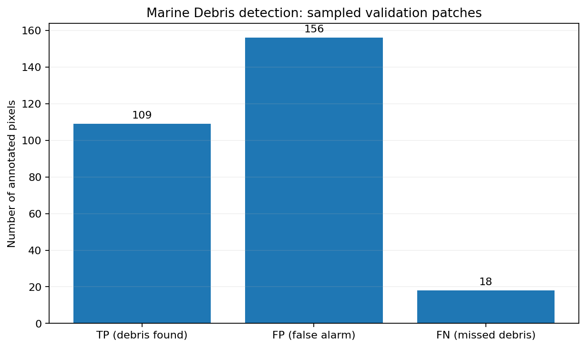
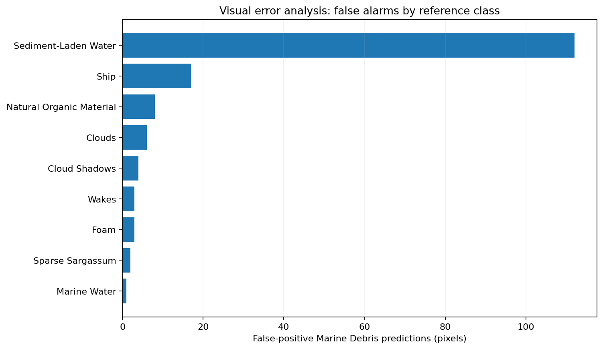
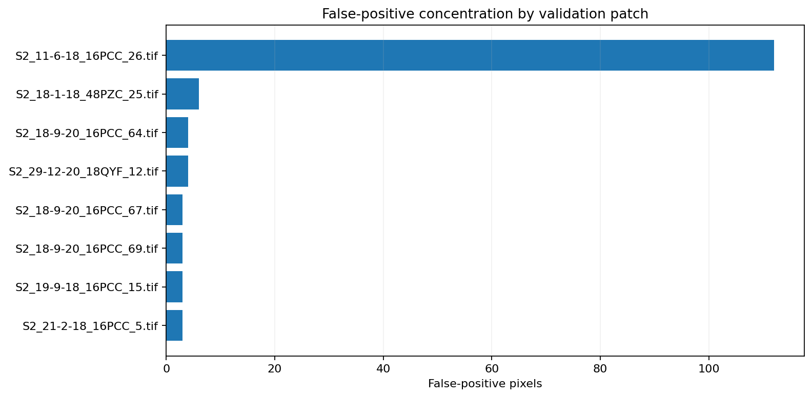

# Visual error analysis: validation subset

## Evaluation scope

The selected Random Forest (`spectral_plus_indices`) was evaluated on **60 sampled validation patches**, using only pixels with valid MARIDA class labels. This is a targeted diagnostic subset, **not** the full validation set, and the test set was not used for selecting the examples.

| Metric | Result |
| --- | ---: |
| Validation patches inspected | 60 |
| Labeled pixels evaluated | 102,285 |
| True-positive Marine Debris pixels | 109 |
| False-positive pixels | 156 |
| False-negative Marine Debris pixels | 18 |
| Marine Debris precision | 41.13% |
| Marine Debris recall | 85.83% |
| Marine Debris F1 | 55.61% |

## False-positive patterns

The largest false-positive source is **Sediment-Laden Water** (112 of 156 errors, **71.8%**). All 112 occur in the same patch, `S2_11-6-18_16PCC_26.tif`, with annotation confidence code 1 (high). The corresponding labeled error positions span rows 95–131 and columns 63–135. This concentrated failure is a priority for checking the raw spectral values, annotation alignment, and image context.

Other false-positive sources are Ship (17), Natural Organic Material (8), Clouds (6), Cloud Shadows (4), Wakes (3), Foam (3), Sparse Sargassum (2), and Marine Water (1). These are observations about the inspected subset, not about the entire validation distribution.

## Missed Marine Debris

Among 18 false negatives, the predicted classes were Clouds (12), Waves (3), Ship (2), and Natural Organic Material (1). The patch `S2_18-9-20_16PCC_39.tif` contributes **13 false negatives** (10 predicted as Clouds and 3 as Waves), alongside 45 correctly identified Marine Debris pixels.

## Priority visual inspections

1. `S2_11-6-18_16PCC_26.tif`: 112 false positives labeled Sediment-Laden Water; check spatial pattern, registration, and spectral units.
2. `S2_18-9-20_16PCC_39.tif`: 13 missed Marine Debris pixels, principally predicted as Clouds; examine the edge and spatial context.
3. `S2_18-9-20_16PCC_29.tif`: mixed errors (6 TP, 3 FP, 2 FN), useful for a compact comparison of success and failure within one patch.

## Methodological cautions

- The full-validation Marine Debris F1 of 81.57% and sampled-patch F1 of 55.61% use different populations; their difference does not establish model degradation or overfitting. In this subset, only 127 of 102,285 evaluated pixels have Marine Debris annotations.
- The observed false positives are highly concentrated. Do **not** discard the difficult patch to inflate reported scores; investigate it and retain it in the documented evaluation.
- The error maps only evaluate annotated pixels. Unlabeled pixels are not automatically treated as negative examples.
- In `patch_error_summary.csv`, a patch with TP=FP=FN=0 receives F1=0 under the current script; such a patch has undefined binary F1, not a documented segmentation failure. There are 35 such patches in this sample. Avoid averaging these per-patch F1 values as though they were meaningful zeros.
- The archive supplied for this review does not contain the five-panel image visualizations from `assets/figures/visual_errors/`. Spatial and spectral explanations are therefore hypotheses pending inspection of those images and validation against the original HDF5 preprocessing.
- Validate that GeoTIFF band values, band order, preprocessing and pixel-to-label alignment match the HDF5 training data before attributing systematic errors to physical scene characteristics.

## Next experiment

After inspecting the two highest-priority patches, test feature ablations (NDMI, NDWI, FDI) using validation for model selection; avoid using the held-out test set to choose variants. Follow with spatial baselines such as multispectral U-Net once pixel alignment and reflectance units are confirmed.
